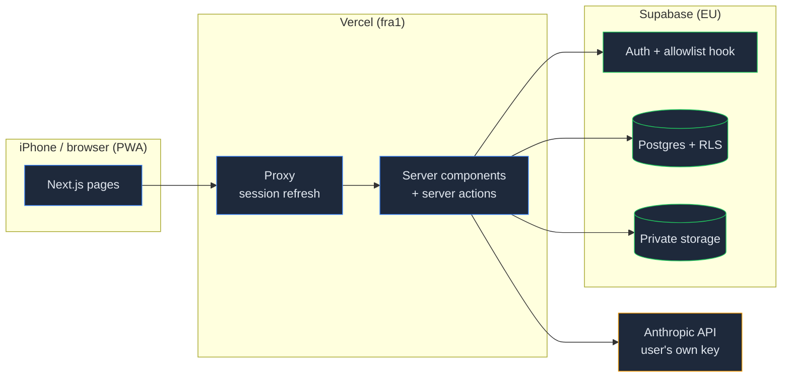

# Hybrid Athlete

An open-source, installable web app for people who lift **and** run. Log sets by voice, snap meals for calories and macros, sync your Garmin through Apple Health, track body composition, and get calorie targets and weekly plans that follow your actual training.

Built for iPhone (add to home screen) and desktop browsers. Hosted by one person for a group of friends, or self-hosted by anyone.

> **Not medical advice.** Targets and plans are estimates for healthy adults. Talk to a professional about injuries, medical conditions or eating disorders.

## Features

| Area | What it does |
|---|---|
| Accounts | Passwordless email sign-in (link or 6-digit code), optional invite-only allowlist |
| Workouts | ~870-exercise library, custom exercises, sets by voice or text ("squat 60 kg 8 reps"), progressive-overload targets, weekly volume per muscle group |
| Activity | Garmin → Apple Health via an iOS Shortcut, `.fit` upload, splits, HR zones, weekly km and training load |
| Body | Weight trend, measurements, body-composition reports (read by AI, confirmed by you), private progress photos, goals |
| Nutrition | Meal photo / description → itemised nutrients (USDA + Open Food Facts), daily calorie and macro targets that follow your training, rest-of-day suggestions that respect allergies |
| Coach | Weekly hybrid plan (strength + running) drafted by AI and checked against deterministic safety rules (volume ramp, 80/20, rest day, no heavy legs before long runs); daily readiness check-in with session adjustments; auto-completion from logged workouts and synced runs; Sunday weekly review |
| Privacy | Row-level security on every table, private file storage, data export, hard account delete |
| AI | Bring your own Anthropic API key (encrypted at rest; AI usage is billed to you) |

Coaching ships in a later release — see `openspec/changes/`.

## Architecture



Stack: Next.js 16 (App Router, React 19, TypeScript strict), Tailwind CSS 4 + shadcn/ui, Supabase (Postgres, Auth, Storage), Anthropic Claude API, Vitest + Playwright.

Specs and design decisions live in [`openspec/`](openspec/) (spec-driven development with [OpenSpec](https://github.com/Fission-AI/OpenSpec)).

## Local development

Requirements: Node 20.19+, pnpm, Docker (Docker Desktop, OrbStack or Colima).

```bash
pnpm install
pnpm db:start                     # starts local Supabase in Docker, applies migrations
cp .env.example .env.local        # fill in the values printed by `pnpm exec supabase status`
openssl rand -base64 32           # paste as APP_ENCRYPTION_KEY
pnpm seed:exercises               # loads the exercise library (safe to re-run)
pnpm dev                          # http://localhost:3000
```

Sign-in emails are caught locally by Mailpit at http://127.0.0.1:54324.

| Command | What it runs |
|---|---|
| `pnpm test` | Unit tests (Vitest) |
| `pnpm test:db` | Database tests against local Supabase (RLS, auth hook, export/delete) |
| `pnpm test:e2e` | Playwright end-to-end tests (iPhone + desktop viewports) |
| `pnpm db:reset` | Recreate the local database from migrations (re-run `pnpm seed:exercises` afterwards) |
| `pnpm seed:exercises` | Upsert the exercise library from [free-exercise-db](https://github.com/yuhonas/free-exercise-db) (public domain), pinned to one commit |
| `pnpm db:types` | Regenerate `src/lib/database.types.ts` |

## Self-hosting

You need a free [Supabase](https://supabase.com) project and a free [Vercel](https://vercel.com) account.

1. **Create a Supabase project** in an EU region (e.g. Frankfurt) if your users are in Europe — this is health data.
2. **Apply the schema:**
   ```bash
   pnpm exec supabase link --project-ref <your-project-ref>
   pnpm exec supabase db push
   # Load the exercise library (idempotent; re-run after upgrading)
   SUPABASE_URL=https://<ref>.supabase.co SUPABASE_SERVICE_ROLE_KEY=<service-role-key> pnpm seed:exercises
   ```
3. **Auth settings** (Supabase dashboard → Authentication):
   - *Hooks* → enable **Before User Created** → Postgres function `auth_hooks.before_user_created`.
   - *Email Templates* → **Magic Link** and **Confirm signup**: paste [`supabase/templates/sign-in.html`](supabase/templates/sign-in.html). It contains both the link and the 6-digit code; the code is what makes sign-in work inside the installed iPhone app, which does not share cookies with Safari.
   - *URL Configuration* → set **Site URL** to your Vercel URL and add `https://<your-domain>/**` to redirect URLs.
   - Configure a custom SMTP sender for production (Supabase's built-in sender is rate-limited).
4. **Invite-only (optional):** add rows to `public.signup_allowlist` in the SQL editor. Each row is an exact email (`friend@example.com`) or a domain (`@example.com`). An empty table means anyone can sign up. Existing users are never locked out.
   ```sql
   insert into public.signup_allowlist (pattern) values ('friend@example.com'), ('@family.dk');
   ```
5. **Deploy to Vercel:** import the repo (functions run in `fra1`, next to an EU database, via `vercel.json`; change it if your database is elsewhere) and add the environment variables:

   | Variable | Where to find it | Exposed to browser |
   |---|---|---|
   | `NEXT_PUBLIC_SUPABASE_URL` | Supabase → Settings → API | yes |
   | `NEXT_PUBLIC_SUPABASE_ANON_KEY` | Supabase → Settings → API (anon / publishable) | yes |
   | `SUPABASE_SERVICE_ROLE_KEY` | Supabase → Settings → API (service role / secret) | **no** |
   | `APP_ENCRYPTION_KEY` | `openssl rand -base64 32` | **no** |
   | `USDA_FDC_API_KEY` (optional) | Free key from [api.data.gov](https://fdc.nal.usda.gov/api-key-signup) — one per deployment, shared by all users (1000 requests/hour; lookups are cached for 30 days). `DEMO_KEY` works for light local testing. Without it, foods are matched via Open Food Facts and labelled AI estimates only. | **no** |

   Losing or changing `APP_ENCRYPTION_KEY` makes stored AI keys unreadable and invalidates Apple Health sync tokens; users re-enter their key and generate a new token.

6. **Install on iPhone:** open the site in Safari → Share → **Add to Home Screen**, then sign in with the emailed code.

Notes: Supabase's free tier pauses projects after a week without activity. Anthropic does not train on API inputs by default; AI features only run for users who add their own key.

## License

[MIT](LICENSE)
