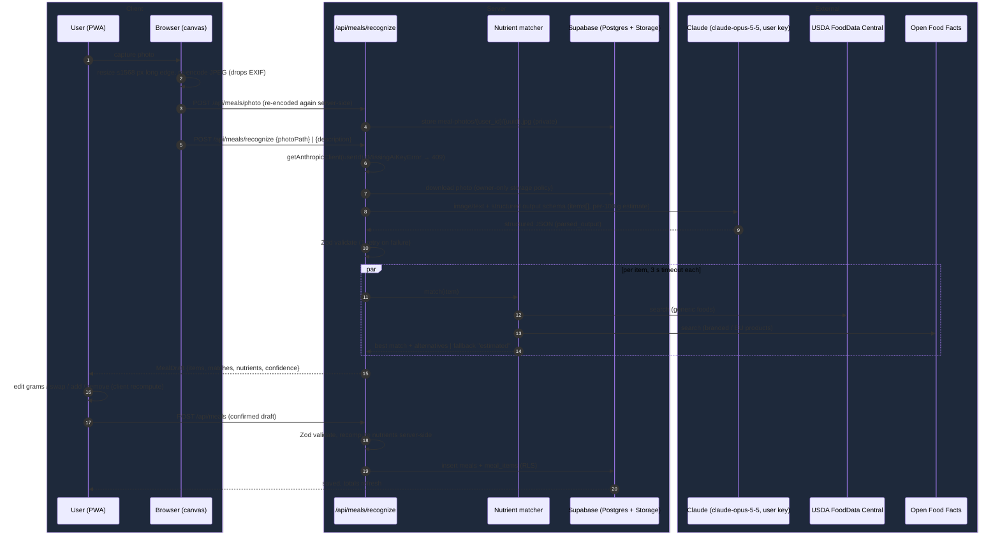
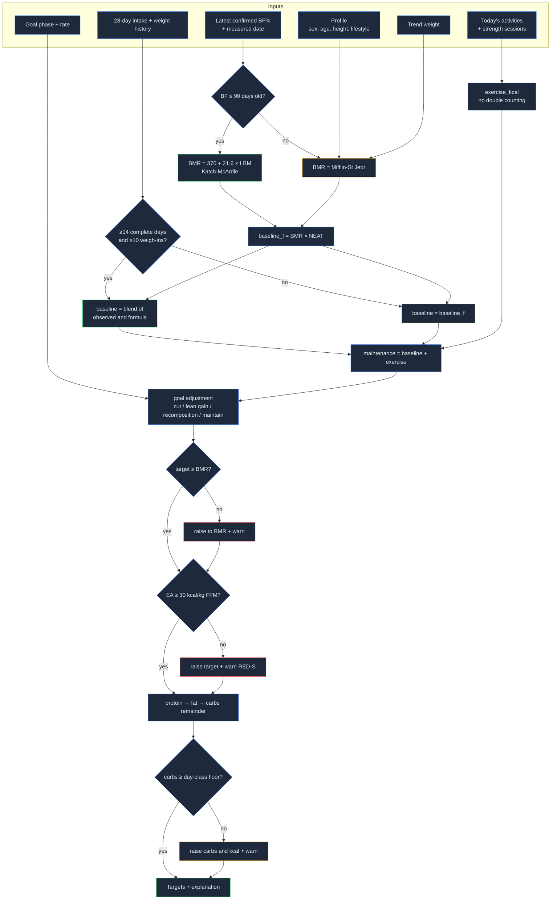
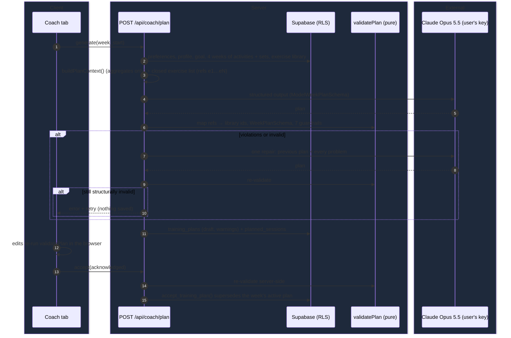
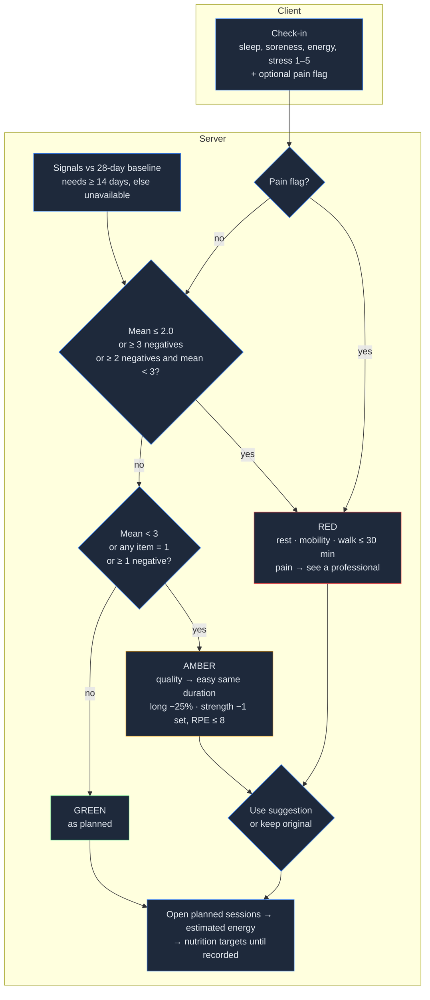

# Architecture

The system overview (PWA → Next.js on Vercel → Supabase + Anthropic) is in the [README](../README.md#architecture).
Per-feature design decisions live in `openspec/changes/*/design.md` (and `openspec/specs/` once archived).

## Nutrition

### Meal draft pipeline

Photo, text description, re-log and planned meals all become an unsaved **draft** that the user confirms.
The model reads the photo with the user's own key; nutrients come from USDA FoodData Central / Open Food Facts,
falling back to the model's labelled estimate. The server recomputes nutrients from per-100 g × grams on save.

### Daily target calculation

Targets are deterministic (`src/lib/nutrition/targets.ts`); the LLM never sets them. Today is recomputed on
every read, past days are frozen once stored.

## Coach

Pure logic lives in `src/lib/coach/` (phase, plan schema, guardrails, readiness, adjustments, planned energy, weekly review); `src/server/coach/` loads data, calls the model and persists. Specs and decisions: `openspec/changes/add-coach/`.

### Weekly plan generation

### Daily readiness and session adjustment

Auto-completion: after a workout session is created, a FIT run is imported or Apple Health workouts are ingested, `syncPlannedCompletions` links each new item to the earliest open compatible session of the active plan on the same local date (one item → one session). Manual mark/skip/undo sets `manual` and is never overridden.
