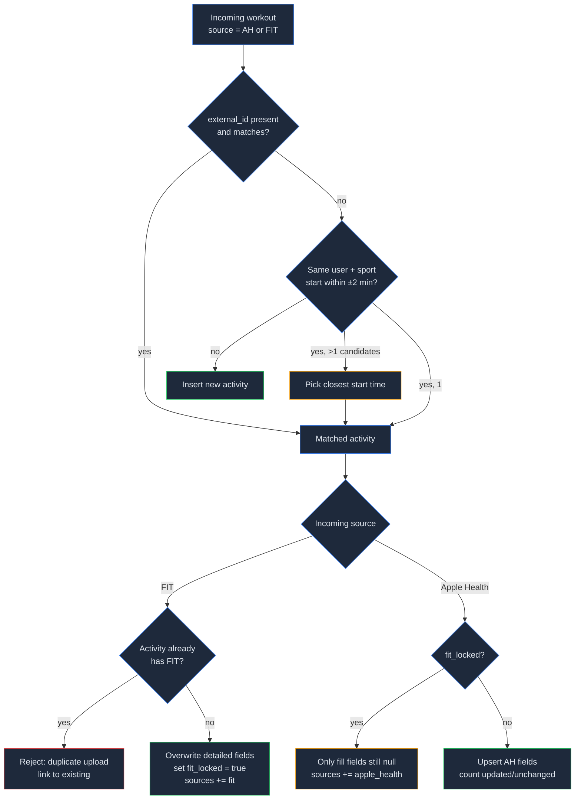
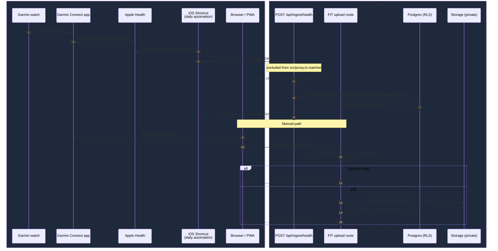

## Context

See proposal.md (Why) for the reasons vendor APIs are excluded. `add-foundation` design provides everything this change builds on: the D3 session model (`src/proxy.ts` + `requireUser()`), the D4 table/RLS/storage conventions, the profile (date of birth, timezone), the D8 export/delete registry, and the rule that the service-role client lives only in `src/server/**` and is checked by an import-allowlist guard test. `add-workout-logging` owns strength sessions logged in-app. This change introduces the first **non-session** authentication path (ingest tokens) and the first binary upload pipeline.

Constraints:
- iOS Shortcuts can read Apple Health samples ("Find Health Samples"), build dictionaries, and POST JSON with custom headers ("Get Contents of URL"). It cannot reliably do retries or complex logic, so the server must be idempotent and tolerant of partial data.
- Garmin Connect writes only a subset of metrics to Apple Health. Steps, active energy, heart rate, resting HR, sleep and workouts are reliable. HRV, VO2max and body weight vary by device and app version.
- Vercel function request bodies are limited (~4.5 MB). FIT files from Garmin are typically 50 KB–3 MB, and zips are smaller.

## Goals / Non-Goals

**Goals:**
- One `activities` model that both sources write into, with deterministic merge rules.
- Ingest endpoint safe to call repeatedly from an unattended automation.
- Derived metrics (splits, zones, load) computed server-side once, stored, and recomputable.

**Non-Goals:**
- A signed, downloadable `.shortcut` file. Shortcut files must be signed via iCloud sharing, so we document the build steps and may later link an iCloud-shared Shortcut.
- Background jobs/queues. All work happens within the request.

## Decisions

### D1. Data model (follows foundation D4)

All user-owned tables use the foundation D4 shape: `user_id uuid not null default auth.uid() references auth.users(id) on delete cascade`, `occurred_at timestamptz`, `local_date date`, `created_at`/`updated_at`, owner policy `using/with check (user_id = (select auth.uid()))`, and an index on `(user_id, local_date)`.

| Table | Key / uniqueness | `occurred_at` / `local_date` | Other columns |
|---|---|---|---|
| `ingest_tokens` | `id`; partial unique `(user_id) where revoked_at is null`; index on `prefix` | n/a (lifecycle timestamps only) | `token_hash` (SHA-256 hex), `prefix` (first 8 chars), `last4`, `revoked_at`, `last_used_at`, `last_result jsonb` |
| `ingest_rate` | `(token_id, window_start)`; `token_id` FK on delete cascade | n/a | `count` |
| `daily_metrics` | unique `(user_id, local_date)` | `local_date` = the payload `date` (the phone's local day); `occurred_at` = that date's local midnight in the profile tz | nullable metric columns with CHECK ranges, `source` |
| `activities` | `id`; unique `(user_id, external_id) where external_id is not null`; index `(user_id, sport, occurred_at)` | `occurred_at` = activity start (UTC); `local_date` computed **at write time** from the profile tz | `sport`, `sub_sport`, `elapsed_s`, `moving_s`, `distance_m`, `avg_hr`, `max_hr`, `elevation_gain_m`, `calories_kcal`, `external_id`, `sources text[]` (`apple_health`, `fit`), `fit_file_path`, `fit_locked boolean`, `load numeric`, `hr_zone_s int[5]`, `max_hr_used`, `max_hr_source` |
| `activity_splits` | `(activity_id, idx)`; `activity_id` FK on delete cascade | inherits from activity (has `user_id` for RLS) | `distance_m`, `duration_s`, `avg_hr`, `elev_delta_m` |

- `daily_metrics`, `activities` and `activity_splits` get the standard D4 owner policy. The browser reads them through the user's RLS client, and FIT import writes through it too (D5).
- **`ingest_tokens` and `ingest_rate`: RLS enabled with no policies**, the same pattern as `user_ai_keys` in foundation D5. `anon`/`authenticated` can't read the hash or anything else. All token operations (generate/rotate/revoke, the masked status read for Settings, verification) go through the server-only module `src/server/ingest/tokens.ts`, which scopes every query to `user_id` from `requireUser()` or from the token lookup.
- Splits get their own table rather than JSONB so they can be queried later (e.g. fastest km by the coach). Zones are fixed at 5, so `int[5]` is sufficient.
- Profile gains nullable `max_hr_bpm smallint check (max_hr_bpm between 100 and 230)`.
- **Registry (foundation D8):** append `daily_metrics`, `activities`, `activity_splits`, `ingest_tokens` (delete via cascade; export yields no secret material because the RLS client sees no rows) and the `activity-files` bucket to `src/server/account/registry.ts`. The registry-completeness test then covers them.

### D2. Ingest token: random secret + SHA-256, not bcrypt

The token is `ha_` + 32 random bytes in base64url. It is high-entropy, so a fast hash (SHA-256) is enough; bcrypt exists to protect low-entropy passwords. Lookup is by `prefix` (indexed), followed by a constant-time comparison of the hash. Rotation is done in one transaction: revoke the active token and insert the new one. The partial unique index enforces a single active token per user. All of this runs in `src/server/ingest/tokens.ts` via the service-role client (see D3), because the table has no client policies.

*Alternative:* Supabase personal access tokens or JWTs. Rejected because Supabase has no per-user API tokens, and long-lived JWTs can't be revoked without a denylist.

### D3. Ingest endpoint: outside the session model, `user_id` only from the token

`POST /api/ingest/health` and `GET /api/ingest/health/schema` are Route Handlers on the Node runtime.

- **Proxy exclusion:** both paths are excluded from the `src/proxy.ts` matcher, so the session refresh and anonymous redirect never run for them. They are the "token-auth API" public branch of the foundation's route-protection graph. The handler never calls `requireUser()` and ignores cookies entirely.
- **Server-side write path:** the route handler is a thin adapter. It calls `src/server/ingest/ingest.ts`, which does the steps below. That module, together with `tokens.ts`, is added to the **service-role import-allowlist guard test**, the only new service-role call sites in this change.
- **Postgres function grants:** `ingest_health(p_user_id uuid, p_payload jsonb)` is `security invoker`, and `execute` is **revoked from `public`, `anon` and `authenticated` and granted only to `service_role`**. A signed-in user calling it via RPC with someone else's id therefore gets a permission error, and `p_user_id` can only come from the server after token verification.

Steps in `src/server/ingest/ingest.ts`:

1. Check `Content-Length` against 1 MB, then enforce the same limit while reading the stream, returning 413.
2. Verify the bearer token (`tokens.ts`), returning 401 for a missing, unknown or revoked token. The resolved `user_id` is the **only** source of ownership; any `user_id`-like field in the payload is rejected by the strict Zod schema.
3. Rate-limit: a fixed hourly window counted in `ingest_rate` (a single `insert … on conflict do update … returning count`), returning 429 with `Retry-After`. Postgres is used instead of Redis to avoid a new dependency at friends scale. Old windows are pruned opportunistically.
4. Validate with a strict Zod schema; failure returns 400 with Zod issue paths.
5. Call `ingest_health(user_id, payload)` through the service-role client. It upserts everything in **one transaction**, takes a per-user advisory lock, and returns `{inserted, updated, unchanged}`. Doing it in SQL keeps the ±2 min matching and the "unchanged" detection (`IS DISTINCT FROM` comparison) atomic, so concurrent Shortcut runs cannot double-insert. `local_date` for workouts is computed inside the function from `profiles.timezone`.
6. Store `last_used_at` and `last_result` on the token row.

Daily upsert semantics: only keys **present** in the payload overwrite columns, using `coalesce(excluded.col, current.col)` driven by a presence mask. Missing keys never null out existing values and never become 0.

The JSON schema is generated from the Zod schema and published at `GET /api/ingest/health/schema`, so the setup guide and the endpoint cannot drift apart.

### D4. Workout matching and merge rules

The same rule serves both sources:

- ±2 min tolerance: Apple Health and FIT start times differ by a few seconds to a minute (start-button press vs. GPS lock). Two minutes absorbs that drift without merging back-to-back sessions such as a warm-up and a workout.
- Sport mapping: FIT `sport` maps to our enum (`running`, `walking`, `cycling`, `training`/`fitness_equipment` → `strength`, `swimming`, other values → `other`). The Shortcut guide maps HealthKit activity types the same way.

### D5. FIT parsing

- Parse with `@garmin/fitsdk` (`Decoder` + `Stream`), which is Garmin's official SDK, maintained and handles developer fields. *Alternative:* `fit-file-parser` (community) was rejected because its maintenance is less certain and the official SDK is free.
- Zips are opened with `fflate` (small, no native dependencies). The zip must contain exactly one `.fit` entry. Uncompressed size is capped at 50 MB to guard against zip bombs.
- The `session` message provides summary fields. `record` messages (timestamp, distance, heart_rate, altitude) drive splits and zones:
  - **Splits**: walk records and cut at each 1000 m cumulative distance boundary, interpolating the timestamp linearly between the bracketing records. The last partial split's pace is normalised per km.
  - **Zones**: time-weighted. Each record interval Δt is attributed to the zone of its HR sample. Intervals > 30 s (pauses) are skipped. Below 50% max HR counts as no zone, which is why zone totals can be less than moving time.
  - Max HR comes from the profile `max_hr_bpm`, otherwise `round(208 − 0.7 × age)` (Tanaka) using age on the activity date. The source used is stored with the activity.
- Recompute zones and load for all of a user's activities when `max_hr_bpm` changes. This is a bounded loop in a server action; at hundreds of activities it takes well under a second.
- Upload flow: the browser sends multipart to a session-authenticated Route Handler (goes through the proxy; `requireUser()`; ≤ 25 MB) → parse in memory → on success, write the file with the **user's RLS client** to `activity-files/<user_id>/<activity_id>.fit`, then call `import_fit_activity(p_activity jsonb, p_splits jsonb)` via the same client. If the DB call fails, the stored object is deleted (compensating action). Parsing happens **before** any write, which satisfies "corrupt files leave no trace". No service role is involved.
- `import_fit_activity` is `security invoker` and granted to `authenticated`. It uses `auth.uid()` (never a parameter) and shares the match/merge SQL (`match_activity(user_id, sport, occurred_at, external_id)`) with `ingest_health`, so both sources follow exactly one rule set (D4). RLS still applies to every statement it runs.

### D6. Keep original FIT files

Originals are kept, not discarded. Parsing logic will improve (e.g. a better zone model, or cadence/power later), and re-deriving from originals avoids asking users to re-export. Cost is small (≈1 MB per run). The files are covered by account export/delete (registered bucket, foundation D8) and per-activity delete. The bucket is private, policies check `(storage.foldername(name))[1] = auth.uid()::text`, and downloads use short-lived signed URLs only.

### D7. Training load model

`load = moving_minutes × zone(avg_hr)`, with a sport default when HR is missing. This is a simplified session-TRIMP. Acute = 7-day sum. Chronic = 28-day sum ÷ 4, i.e. per-week units so the ratio reads directly. The ratio is hidden until 21 days of history exist because an early ratio is noise. Windows are computed on the stored `local_date`. *Alternative:* Banister TRIMP or exponentially weighted ACWR. Deferred because the precision isn't needed for v1 coaching, and the formula is isolated in one pure function that is easy to swap.

Strength sessions logged in-app (from `add-workout-logging`) are **not** included in this load; that decision is left to `add-coach`.

### D8. Flow overview

The Shortcut sends the **last 2 local days** on every run. Idempotency makes the overlap free, and it catches late-arriving sleep data and Garmin syncs that land after midnight.

### D9. Timezones

`daily_metrics.local_date` is the payload `date`, trusted as the phone's local day because Apple Health already aggregates by it. Activities get `local_date` computed **once at write time** from the profile timezone (foundation D4). Days and Monday–Sunday weeks are grouped by `local_date`, so an activity never moves day if the user later changes timezone. Times in lists are rendered from `occurred_at` in the current profile timezone. If the phone and profile timezones differ (travel), daily metrics follow the phone and activities follow the profile. This is accepted for v1 and documented.

### D10. Charts: Recharts
First change with charts (weekly km, HR zones, daily-metric trends). Recharts: React-native composition, SVG output that scales with text size, small API, works with server-rendered pages via client islands. Later changes (body trends, nutrition, coach review) reuse it. No second chart library.
*Alternatives:* Chart.js (canvas, poorer accessibility), Visx (more code per chart), Tremor (pulls in its own design system on top of shadcn/ui).

### Implementation notes (decided while building)
- **HR histogram instead of re-parsing files.** `activities.hr_histogram` (jsonb, seconds per bpm) is stored at import. Zones are recomputed from it when max HR changes (`recomputeActivityZones`, called from the profile save action when `max_hr_bpm` or birth date changes), so stored FIT files are never re-downloaded.
- **Load is computed in TypeScript, not SQL.** The ingest module validates the strict client schema, then adds server-only `load`/`max_hr_used`/`max_hr_source` per workout before calling `ingest_health`, so one tested formula (`src/lib/activities/load.ts`) serves both sources. An average HR below zone 1 counts as intensity 1 (never 0 load).
- **Extra service-role SQL functions:** `rotate_ingest_token` (revoke + insert in one transaction) and `bump_ingest_rate` (upsert-increment of the hourly window, pruning windows older than a day). Both are `service_role` only.
- **Shortcut-friendly payload:** whole-number metrics sent as decimals (8234.0) are rounded instead of rejected, and several `daily` entries for the same date merge in order. The guide uses one entry per metric per day, which is much simpler to build in Shortcuts.
- **Last sync survives rotation:** Settings shows the most recent successful sync across all of the user's tokens.
- **Routes and pages:** `POST /api/activities/upload` (multipart, field `file`; the stored original is the extracted `.fit`, not the zip); `/train/activities` (upload, weekly volume chart and table, training load, list with sport filter), `/train/activities/[id]`, `/train/recovery` (daily metrics, 7-day averages), `/settings/apple-health` (guide); an "Apple Health sync" card in Settings and an activity/steps card on Today.
- **Upload size in production:** Vercel caps request bodies at ~4.5 MB, below the 25 MB app limit. Garmin FIT exports are typically well under that.

## Risks / Trade-offs

- [Shortcut "Find Health Samples" may not expose workouts on every iOS version, or may expose them without distance/HR] → The ingest contract treats workouts as optional. FIT upload remains the complete path. Verify on a real iPhone (iOS 26) before finalising the guide.
- [Shortcuts' Personal Automations for Health data may require the phone to be unlocked, or may prompt before running] → Document "Run Immediately"/"Notify when run" settings and show last-sync staleness (> 36 h) as a warning in Settings.
- [Garmin may not write HRV/VO2max/weight to Apple Health] → All fields are nullable and shown as "not available". The coach must treat them as optional.
- [Token leakage via a shared Shortcut] → The guide warns never to share the Shortcut with the token embedded. Rotation is one tap. The token only grants write access to ingest (no read API).
- [Clock drift > 2 min between sources creates duplicate activities] → The user can delete the duplicate. Log match misses at debug level so the window can be tuned later.
- [Large FIT files from ultra-length activities] → The 25 MB cap is well above a 6 h run (~5 MB). Rejection gives a clear message.
- [Rate-limit table growth] → Old windows are deleted opportunistically on insert (`delete … where window_start < now() - interval '1 day'`).

## Migration Plan

- Additive migrations only: new tables, the bucket, the `profiles.max_hr_bpm` column, the `ingest_health`, `import_fit_activity` and `match_activity` functions, and their `execute` grants.
- Register `daily_metrics`, `activities`, `activity_splits`, `ingest_tokens` and the `activity-files` bucket in `src/server/account/registry.ts`. Account deletion then removes `<user_id>/` objects first and cascades rows (foundation D8).
- Exclude `/api/ingest/health` and `/api/ingest/health/schema` from the `src/proxy.ts` matcher.
- Add `src/server/ingest/tokens.ts` and `src/server/ingest/ingest.ts` to the service-role import allowlist.
- Rollback: drop the new tables, function and bucket. Nothing existing depends on them.

## Open Questions

- Whether to publish an iCloud-shared Shortcut link in addition to the manual build steps. This can be decided after on-device testing and doesn't change the API contract.
- Exact HealthKit → sport mapping table for less common activity types (e.g. HIIT, rowing → `other`). Refine from real payloads.
