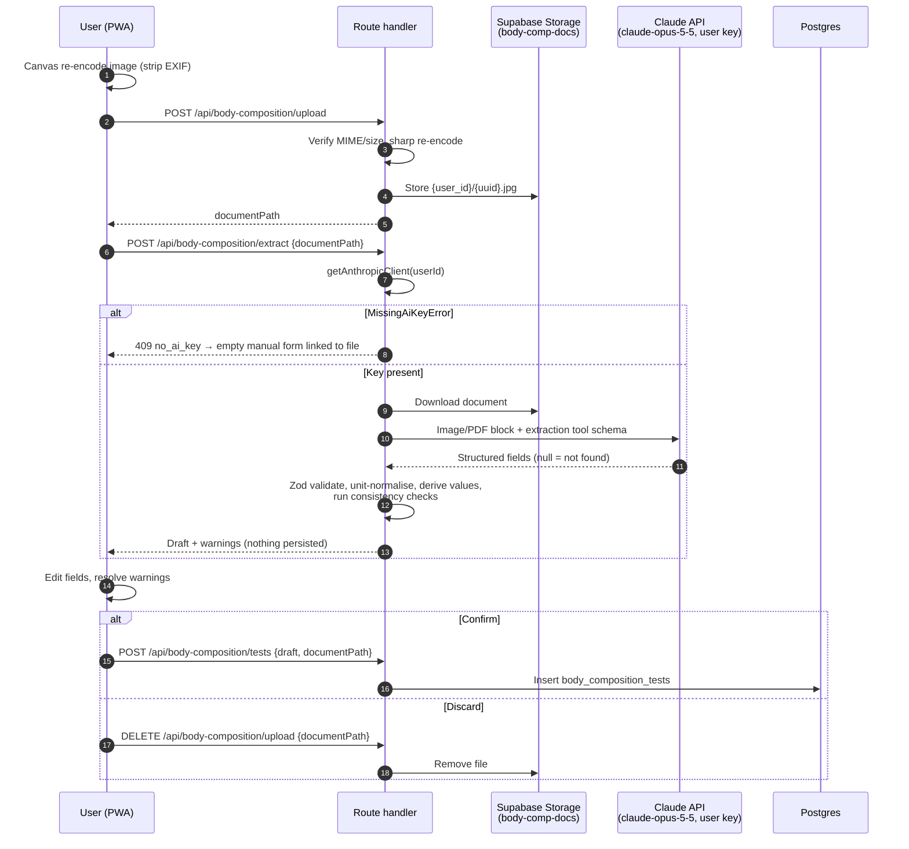

## Context

See proposal.md for motivation. This change builds on:

- `add-foundation`: data-layer conventions (design D4), profile (`sex` male/female, `height_cm`, `timezone`, `strength_experience`), `getAnthropicClient(userId)` + model constants (D6), export/delete table registry (D8).
- `add-activity-sync`: `daily_metrics` keyed by user + local date, which already holds Apple Health `weight_kg` (one value per date, no time of day), and the chart library chosen there.

Constraints that shape the design:

- Vercel serverless functions reject request bodies over 4.5 MB; iPhone photos are 2–6 MB and often HEIC.
- Body data is GDPR special-category data; photos are the most sensitive artefact in the app.
- Daily scale weight is noisy (±1–2 kg from water, glycogen and sodium), more so with rising run volume.
- Downstream consumers (`add-nutrition`, `add-coach`) need a stable read API for "latest body composition" and "goal phase + target rate" that does not depend on UI code.

## Goals / Non-Goals

**Goals:**

- All body maths (canonical daily weight, trend, rate, derived composition values, consistency checks, goal phase, projections, timeline) lives in pure, framework-free TypeScript modules with exhaustive unit tests.
- No AI value reaches the database without an explicit user confirmation.
- No image is persisted with EXIF/GPS metadata.
- One read function per downstream need, so `add-nutrition` never queries body tables directly.

**Non-Goals:**

- Storing derived series (trend weight, phase). They are computed on read; data volume (≤ a few thousand rows per user) makes this trivial and removes cache invalidation.
- Background jobs or cron infrastructure.
- Image editing, cropping or pose alignment.

## Decisions

### 1. Data model

Every table follows foundation D4 verbatim: `id`, `user_id ... references auth.users(id) on delete cascade`, `occurred_at timestamptz`, `local_date date` computed **at write time** from the profile timezone, `created_at`/`updated_at`, the `<table>_owner` policy using `(select auth.uid())`, and an index on `(user_id, local_date)`.

| Table | Domain columns | Notes |
|---|---|---|
| `body_weights` | `weight_kg numeric(5,2)` | Manual entries only. `occurred_at` = weigh-in instant. `CHECK (weight_kg BETWEEN 20 AND 400)`. |
| `body_measurements` | `waist_cm`, `hips_cm`, `chest_cm`, `arm_cm`, `thigh_cm` | `CHECK` at least one non-null; each 10–250 cm. |
| `body_composition_tests` | `method` enum, `weight_kg`, `body_fat_pct`, `fat_mass_kg`, `lean_mass_kg`, `skeletal_muscle_kg`, `visceral_fat_level`, `bmr_kcal`, `total_body_water_kg`, `segmental_lean jsonb`, `derived_fields text[]`, `source` (`manual`/`extracted`), `document_path` | `local_date` = test date printed on the report; row created only on confirm. |
| `progress_photos` | `pose` enum (`front`/`side`/`back`), `storage_path`, `width`, `height` | `local_date` = photo date chosen by the user. |
| `progress_photo_analyses` | `photo_a_id`, `photo_b_id`, `observations text[]`, `model` | Photo FKs `ON DELETE CASCADE` so deleting a photo removes its analyses. No visual-impression column (see implementation notes). |
| `body_goals` | `goal_weight_kg`, `goal_body_fat_pct`, `target_date`, `status` (`active`/`archived`), `archived_at` | Partial unique index `(user_id) WHERE status = 'active'`; `CHECK` at least one goal value. |

For date-only records (tests, photos, measurements) `occurred_at` is the start of `local_date` in the user's timezone, so every table still sorts on one instant column.

`profiles` gains `progress_photo_ai_consent_at timestamptz null` (null = no consent).

Storage buckets `body-comp-docs` and `progress-photos` are private, objects live at `<user_id>/<uuid>.<ext>`, and policies check `(storage.foldername(name))[1] = auth.uid()::text` (D4). Files are served only through signed URLs with a 600 s expiry, created server-side.

Apple Health weights are **not** copied: they stay in `daily_metrics` and are read through a view.

**Alternative considered:** copying Apple Health weights into `body_weights` with `source = 'apple_health'`. Rejected — two copies of the same fact drift when the Shortcut re-posts corrected values.

### 2. Canonical daily weight as a SQL view

`daily_body_weight` (with `security_invoker = true` so RLS applies) returns one row per user per `local_date`: the `body_weights` row with the earliest `occurred_at` on that `local_date`, else `daily_metrics.weight_kg` for that date, plus a `source` column. Because `local_date` is fixed at write time (D4), the view needs no timezone arithmetic. The trend/rate maths runs in TypeScript over this ordered series.

**Alternative considered:** computing the EWMA in SQL with a recursive CTE. Rejected — harder to test, and the sequential gap-filling logic reads far better as a pure function.

### 3. Trend and rate maths

- Trend: EWMA with α = 0.1 over a gap-free daily series (missing days carry the previous trend forward), seeded with the first daily weight. α = 0.1 ≈ a 10-day smoothing window, the same idea as the "Hacker's Diet" trend line, which keeps a single salty dinner or a long-run glycogen refill from showing up as fat gain.
- Rate: `(trend[today] − trend[today−14]) / 2` kg/week, and as % of `trend[today−14]`. Requires ≥ 7 actual daily weights in the window.

### 4. Image handling: normalise on the client, verify on the server

```mermaid
graph LR
  subgraph Client
    A[File picker / camera] --> B[Canvas re-encode<br/>JPEG q0.85, long edge ≤ 2048px<br/>drops EXIF, decodes HEIC natively in Safari]
  end
  subgraph Server
    C[Route handler<br/>size + MIME check] --> D[sharp .rotate&#40;&#41; re-encode<br/>strips any remaining metadata]
    D --> E[(Private bucket<br/>user_id/uuid.jpg)]
  end
  B -->|< 1 MB typical| C
  style A fill:#1e293b,stroke:#3b82f6,color:#e2e8f0
  style B fill:#1e293b,stroke:#3b82f6,color:#e2e8f0
  style C fill:#1e293b,stroke:#3b82f6,color:#e2e8f0
  style D fill:#1e293b,stroke:#22c55e,color:#e2e8f0
  style E fill:#1e293b,stroke:#22c55e,color:#e2e8f0
```



- Client-side canvas re-encode solves three problems at once: HEIC (Safari decodes it, sharp's prebuilt binaries do not), the 4.5 MB Vercel body limit, and metadata removal before bytes leave the phone.
- The server never trusts the client: `sharp(input).rotate().jpeg()` re-encodes again (sharp drops metadata unless `withMetadata()` is called), and a test asserts the stored bytes contain no EXIF segment.
- The spec's 15 MB / 10 MB limits apply to the **original** file and are checked client-side before re-encoding; the server enforces a 4 MB post-normalisation limit.
- **PDF reports** cannot be canvas-encoded and may exceed 4.5 MB, so they are uploaded straight to the `body-comp-docs` bucket with a short-lived signed upload URL scoped to `{user_id}/`. PDFs carry no GPS data; the metadata-stripping requirement applies to images.

**Alternative considered:** server-only processing with `sharp` + `libheif`. Rejected — needs a custom sharp build on Vercel and still hits the body limit.

### 5. Body composition extraction



- AI calls go through foundation's `getAnthropicClient(userId)` with the shared vision model constant (D6); `MissingAiKeyError` maps to the manual-entry fallback, and an Anthropic 401 follows the foundation "key no longer valid" path.
- Extraction uses a single tool/JSON-schema definition with every field nullable plus a `unit` hint for masses (kg/lb); the prompt says "copy printed values only, never estimate, null when absent". PDFs go to Claude as native document blocks (no PDF-to-image conversion needed).
- Derived values (lean = weight − fat mass, etc.) and consistency checks run in the shared pure module, **after** Zod validation, so they behave identically for manual and extracted entries.
- Abandoned uploads (user closes the app mid-flow) are cleaned lazily: on each new upload the route deletes that user's unreferenced files older than 24 h. No cron needed.

### 6. Progress photo analysis

- Requests are refused server-side (not just hidden in the UI) unless `progress_photo_ai_consent_at` is set; the consent screen copy states images go to Anthropic under the user's own key.
- The route checks both photos belong to the caller and share a pose, downloads them server-side, and calls Claude through `getAnthropicClient(userId)` with a tool schema `{ observations: string[], visual_impression: string | null }`. The prompt asks for observable, non-judgemental changes in definition, shape and posture, and forbids presenting a body fat number as a measurement.
- `visual_impression` is returned once in the analysis response and rendered with the fixed label "visual impression, not a measurement"; it is never persisted (spec: "SHALL NOT store … a body-fat figure derived from photos"). Observations containing a percentage figure are dropped server-side. A test enforces that the "latest body composition" reader ignores analyses.

### 7. Goal phase derivation

```mermaid
graph TD
  subgraph Server
    S([Active goal]) --> W{Trend weight<br/>available?}
    W -- no --> NW[No phase:<br/>ask to log weight]
    W -- yes --> G{Goal weight<br/>set?}
    G -- yes --> D[Δ = goal weight − trend weight]
    G -- no --> BC{Latest body<br/>comp exists?}
    BC -- no --> NB[No phase:<br/>ask for body comp test<br/>or goal weight]
    BC -- yes --> IW[Implied goal weight =<br/>lean mass / &#40;1 − goal BF%&#41;] --> D
    D --> C1{Δ < −2 kg}
    C1 -- yes --> CUT[Cut<br/>−0.5 %BW/wk default, max −1.0]
    C1 -- no --> C2{Δ > +2 kg}
    C2 -- yes --> LG[Lean gain<br/>+0.5 / 0.25 / 0.125 kg/month<br/>by experience]
    C2 -- no --> C3{Goal BF% ≤<br/>current BF% − 1?}
    C3 -- yes --> RC[Recomposition<br/>0 kg/wk]
    C3 -- no --> MT[Maintain<br/>0 kg/wk]
    CUT --> TD{Target date set?}
    LG --> TD
    TD -- required rate > max --> WARN[Warn +<br/>earliest safe date]
    TD -- default < required ≤ max --> REQ[Use required rate]
    TD -- no date / slower --> DEF[Use default rate]
  end
  style S fill:#1e293b,stroke:#3b82f6,color:#e2e8f0
  style W fill:#1e293b,stroke:#3b82f6,color:#e2e8f0
  style G fill:#1e293b,stroke:#3b82f6,color:#e2e8f0
  style BC fill:#1e293b,stroke:#3b82f6,color:#e2e8f0
  style IW fill:#1e293b,stroke:#3b82f6,color:#e2e8f0
  style D fill:#1e293b,stroke:#3b82f6,color:#e2e8f0
  style C1 fill:#1e293b,stroke:#3b82f6,color:#e2e8f0
  style C2 fill:#1e293b,stroke:#3b82f6,color:#e2e8f0
  style C3 fill:#1e293b,stroke:#3b82f6,color:#e2e8f0
  style TD fill:#1e293b,stroke:#3b82f6,color:#e2e8f0
  style CUT fill:#1e293b,stroke:#22c55e,color:#e2e8f0
  style LG fill:#1e293b,stroke:#22c55e,color:#e2e8f0
  style RC fill:#1e293b,stroke:#22c55e,color:#e2e8f0
  style MT fill:#1e293b,stroke:#22c55e,color:#e2e8f0
  style REQ fill:#1e293b,stroke:#22c55e,color:#e2e8f0
  style DEF fill:#1e293b,stroke:#22c55e,color:#e2e8f0
  style WARN fill:#1e293b,stroke:#f59e0b,color:#e2e8f0
  style NW fill:#1e293b,stroke:#ef4444,color:#e2e8f0
  style NB fill:#1e293b,stroke:#ef4444,color:#e2e8f0
```



- Phase, projections and timeline are **derived on read**, never stored: they depend on today's trend weight and latest test, which change daily.
- Rationale for the defaults (coach/nutrition view): a 0.5 %/week cut protects lean mass and keeps enough energy for quality runs. 1.0 %/week is the upper bound for trained people with higher body fat. Lean-gain rates follow novice/intermediate/advanced muscle-gain expectations so a "bulk" does not turn into fat gain. Recomposition gets a 0 kg/week target because it is driven by protein and training rather than an energy deficit.
- The ±2 kg band absorbs normal water noise so a 1 kg difference never flips someone into a cut.

### 8. Read API for downstream changes

`src/server/body/read.ts` (`import "server-only"`) exports two functions used by `add-nutrition` and `add-coach`:

- `getLatestBodyComposition(userId)` → `{ testedOn, method, bodyFatPct, leanMassKg } | null`
- `getGoalState(userId)` → `{ phase, targetRateKgPerWeek, goalWeightKg, ... } | null`

Both reuse the pure modules; consumers never query body tables directly.

### 9. Module layout

Follows foundation's split: pure code in `src/lib`, server-only code in `src/server`.

```
src/lib/body/          trend.ts, rate.ts, composition.ts, goals.ts      (pure, unit-tested)
src/lib/images/        normalize-client.ts                              (canvas re-encode)
src/server/body/       read.ts, uploads.ts (lazy orphan cleanup)        (server-only)
src/server/images/     normalize.ts                                     (sharp)
src/app/(app)/body/    weight, measurements, composition, photos, goals pages
src/app/api/body-composition/*, src/app/api/progress-photos/*          (all call requireUser())
supabase/migrations/<ts>_body_tracking.sql
```

- `local_date` for new rows comes from foundation's `localDate(instant, tz)` in `src/lib/time.ts`; unit conversion from `src/lib/units.ts`.
- All reads/writes and signed-URL creation use the user's RLS-scoped Supabase client. The service-role client is **not** used anywhere in this change, so foundation's admin-import guard test stays green.
- Charts reuse the library introduced by `add-activity-sync`; no second chart dependency.

### Implementation notes (decided while building)
- **Visual impression is not stored.** The spec forbids storing a photo-derived body-fat figure, so `progress_photo_analyses` has no `visual_impression` column. The impression is returned once with the analysis and shown with its label. Observations that contain a `%`/"percent" figure are filtered out server-side; if nothing usable remains the analysis fails rather than saving.
- **AI calls use structured outputs, not tools.** Extraction and photo analysis call `client.beta.messages.parse` with `betaZodOutputFormat(schema)`, `output_config.effort: "medium"`, and refusal fallbacks (`betas: ["server-side-fallback-2026-07-01"]`, `fallbacks: "default"`). Forced `tool_choice` is rejected by Claude Opus 5.5. `stop_reason === "refusal"` and a null `parsed_output` map to "unreadable" (manual form).
- **Read API takes the RLS client.** `getLatestBodyComposition(db)` and `getGoalState(db, profile, today?)` take the caller's RLS-scoped client (matching every other server module) rather than a bare `userId`. `getGoalState` returns `{ state, evaluation }` or `{ state: null, reason: "no_goal" | "needs_weight" | "needs_body_comp" }`.
- **Atomic goal replacement.** `replace_body_goal(...)` (SQL, `security invoker`, so RLS applies) archives the active goal and inserts the new one in one transaction; the partial unique index backs it up.
- **Lean → fat derivation.** Besides the three spec formulas, fat mass is derived as weight − lean mass when only those two are present (InBody prints lean mass; without it, body fat % could not be derived).
- **Bucket-level limits.** `body-comp-docs` allows `image/jpeg` + `application/pdf` up to 10 MB; `progress-photos` allows `image/jpeg` up to 4 MB (post-normalisation). Storage rejects anything else even if the app check were bypassed.
- **Hydration-safe file inputs.** The report wizard processes a file picked before hydration on mount; the photo form reads the file from `FormData` on submit rather than component state.
- **`startOfLocalDay(date, tz)`** was added to `src/lib/time.ts` for date-only records (tests, photos, measurements).
- **`sharp` needs no build approval.** sharp ≥ 0.33 ships prebuilt `@img/sharp-*` binaries as optional dependencies, so `pnpm-workspace.yaml` (`sharp: false`) is unchanged; on Vercel the linux-x64 binary is installed at build time.
- **E2E AI stubbing.** The Claude calls are unit-tested with mocked clients; Playwright stubs `/api/body-composition/extract` and `/api/progress-photos/analyze` at the network boundary so the real upload, confirmation and save paths run end to end.
- **Routes and pages:** `/body` (weight log, trend chart with 4w/12w/1y, rate, waist change, history with edit/delete), `/body/measurements`, `/body/composition` (+ `/new`, `/[id]`), `/body/photos` (+ `/compare`), `/body/goal`; Settings gains an "AI photo analysis" consent card; Today gains a Body card. APIs: `/api/body-composition/{upload,extract,tests,tests/[id]}`, `/api/progress-photos`, `/api/progress-photos/[id]`, `/api/progress-photos/analyze`.

## Risks / Trade-offs

- [Claude misreads a digit (18.5 → 81.5)] → mandatory confirmation, range checks and the fat + lean ≈ weight check catch most misreads before saving.
- [Bioimpedance (InBody/Tanita/Withings) varies ±3–5 % with hydration, so users chase noise] → method-labelled points, trend lines only within one method, a mixed-method notice, and the UI shows the test date and method beside any value used downstream.
- [Stale body composition (test months old) drives Katch-McArdle in nutrition] → `getLatestBodyComposition` returns `testedOn`; consumers decide on staleness. Body UI shows the test's age.
- [Canvas re-encoding loses quality or fails on very large images on older iPhones] → cap the long edge at 2048 px (enough for comparison and extraction); fall back to an error asking the user to choose a smaller image.
- [Photos are the most sensitive data in the app] → private bucket, path-prefix storage policies, 10-minute signed URLs generated server-side, explicit AI consent enforced server-side, EXIF stripped twice.
- [User travels or changes timezone] → per foundation D4 `local_date` is fixed at write time, so past entries never move days; only new entries use the new timezone.
- [Lazy orphan cleanup leaves files when a user never uploads again] → bounded (one abandoned file at most per abandoned flow) and fully removed by account deletion.

## Migration Plan

1. Apply `supabase/migrations/<ts>_body_tracking.sql` (tables, view, enums, RLS, buckets, storage policies). Additive only; no existing data touched.
2. Append the six new tables and both buckets to `src/server/account/registry.ts` (foundation D8); its registry test fails CI if any is missing.
3. Rollback: drop the new tables, view, buckets and the profile column. No other change depends on this one until `add-nutrition` ships.
