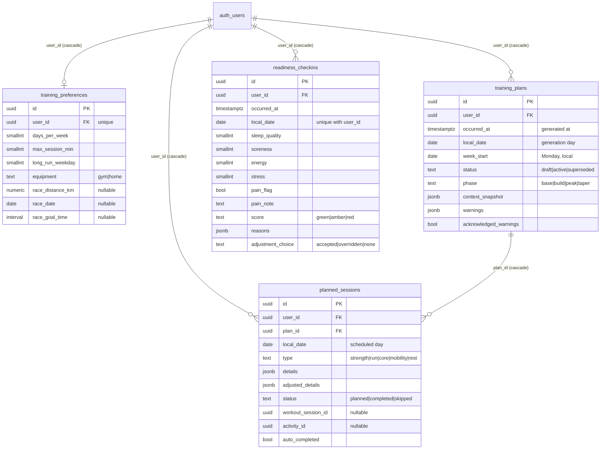
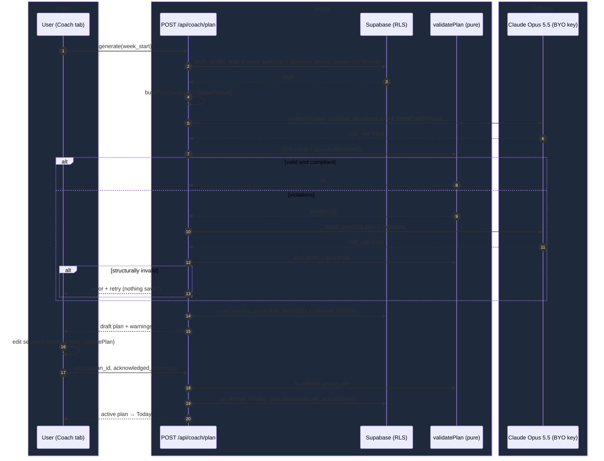

## Context

See proposal.md (Why). This change sits on top of everything else and adds no new data sources; it only reads what earlier changes record:

- `workout-logging` / `progressive-overload`: sessions, working sets per exercise, exercise → muscle-group mapping. Progressive-overload targets are applied when a planned strength session is logged, not in the plan.
- `activity-history`: activities (sport, start, moving minutes, distance, avg HR zone, active kcal), per-activity load, acute and chronic load and their ratio, and daily metrics (resting HR, HRV, sleep).
- `body-goals` / `body-metrics`: goal phase (cut, recomp or gain) and trend weight.
- `nutrition-targets`: daily target pipeline with exercise energy and the training-day carbohydrate floor.

Constraints: BYO Anthropic key per user; LLM output must be structured and Zod-validated; every safety rule must be deterministic and unit-testable; "day" means the user's local date.

## Goals / Non-Goals

**Goals:**
- Pure, side-effect-free TypeScript for phase derivation, guardrail validation, baseline statistics, readiness scoring, session adjustment and planned-energy estimation, so these modules can be tested exhaustively without Supabase or the AI.
- One LLM round-trip in the normal case, at most two (initial + one repair) per generation.
- Plans and readiness stay correct when the user has no wearable, no history, or no API key (readiness and review figures need no key).

**Non-Goals:**
- Server-side scheduling or cron. Everything is computed on request, with no nightly jobs.
- Caching LLM outputs across users or prompt-sharing between users.

## Decisions

### D1. The LLM proposes, deterministic code disposes
The AI writes the plan; `validatePlan(plan, context)` decides whether it is safe. Guardrail rules live in `src/lib/coach/guardrails.ts` as a list of named rule functions returning `Violation { rule, message, dayIndexes, sessionIds }`. The same validator runs after generation, after the repair, and after every user edit (client-side for instant feedback, re-run server-side on accept).
*Alternative considered:* putting the rules only in the prompt. Rejected because the LLM can't be trusted to enforce numeric limits, and the user's safety must not depend on prompt adherence.

### D2. Structured output via a single tool definition, through the foundation AI client
Generation gets its SDK client from the foundation's `getAnthropicClient(userId)` (`src/server/ai`) and its model ID from the shared model constants (`AI_MODELS.main`), never a literal string. It calls `messages.parse` with structured output generated from the Zod `WeekPlanSchema` (days[7] → sessions[] discriminated on `type`). The prompt includes only IDs and names of exercises filtered to the user's equipment (gym or home) and grouped by primary muscle, so the model picks from a closed set. After parsing, unknown exercise IDs are a structural violation (D3). Tool-use calls follow the `claude-api` skill reference at implementation time.
`MissingAiKeyError` is caught at the route boundary and mapped to a "no key" response, and the UI disables the generate and summary actions with a link to Settings. Readiness, session adjustment, auto-completion, planned-energy estimates and the weekly review figures never touch the AI client, so they keep working without a key. An Anthropic 401 surfaces as the foundation's "key no longer valid" state.
*Alternative considered:* free-text JSON in the reply. Rejected because it has more parse failures and no schema guidance.

### D3. One repair, then show with warnings
If Zod parsing fails or any guardrail is violated, a second call sends the previous tool input plus a bullet list of violations ("Rule 4: long run 14 km is 41% of 34 km; max 35%"). The result is re-validated:
- structurally invalid → error and retry button, nothing persisted;
- guardrail-violating → persisted as `draft` with `warnings` (jsonb). Accept requires `acknowledged_warnings = true`.
This caps cost and latency (≤ 2 calls) and never silently hides a bad plan.

### D4. Context assembly is a pure function over pre-fetched data
`buildPlanContext(prefs, history4w, profile, goal, today)` returns a compact summary: weekly run km for each of the last 4 weeks and their average, longest run, typical easy pace, strength working sets per muscle group per week, sessions per week, phase, weeks-to-race, and experience levels. Raw activity rows are never sent. This keeps prompts small, makes the guardrail baseline (4-week average) identical to what the model saw, and limits personal data sent to the AI.

### D5. Data model (foundation D4 conventions)

Every table follows the foundation D4 template: `id uuid` PK, `user_id uuid not null default auth.uid() references auth.users(id) on delete cascade`, `created_at`/`updated_at`, RLS enabled with a single `<table>_owner` policy `for all to authenticated using/with check (user_id = (select auth.uid()))`, and an index on `(user_id, local_date)`. Event-like rows carry `occurred_at timestamptz` (UTC instant) and `local_date date` computed once at write time from the profile timezone via `localDate(instant, tz)`. `training_preferences` is a per-user settings row, not an event, so it has `unique (user_id)` and no `occurred_at`/`local_date`.

- `planned_sessions` carries its own `user_id` (not ownership-through-plan) so it uses the standard owner policy. `local_date` here is the scheduled day, not the write day: it is set from the plan's `week_start` + day index, which is consistent with D4's "day in user's tz" semantics.
- A partial unique index on `training_plans (user_id, week_start) WHERE status = 'active'` enforces one active plan per week. Accept is a single SQL function, `accept_training_plan(plan_id)` (security invoker, so RLS applies), that supersedes the old plan and activates the new one in one transaction.
- `unique (user_id, local_date)` on `readiness_checkins` with `insert … on conflict do update` makes resubmission replace the day's row.
- Readiness `score` and `reasons` are stored at submission time (an audit of what the user saw). The objective signals used are snapshotted in `reasons`.
- `context_snapshot` stores the D4 summary so a later review can explain why the plan looked the way it did.
- All four tables are appended to the foundation's export/delete registry (`src/server/account/registry.ts`, foundation D8). Deletion needs nothing else because of the `auth.users` cascade, and this change adds no storage buckets.

### D6. Auto-completion matching
On workout-session save and on activity insert (the ingest route, FIT import and the app's own strength log), `matchPlannedSession(userId, localDate, kind)` finds the earliest incomplete planned session on that date with a compatible type (`strength` and `core` ← workout session; `run` ← activity with sport `running` or `trail_running` or `treadmill`). It links the item by id and sets `auto_completed = true`. Each item can satisfy only one session (unique partial indexes on `workout_session_id` and `activity_id`). Hooking into the existing write paths is a single call after insert, with no triggers, so the logic stays in tested TypeScript.
*Alternative considered:* Postgres triggers. Rejected because the logic needs user-timezone date resolution and unit tests.

### D7. Readiness scoring and baselines

```mermaid
graph TD
  subgraph Client
    CI[Check-in<br/>sleep, soreness, energy, stress 1-5<br/>+ optional pain flag]
  end
  subgraph Server
    SIG[Objective signals vs 28-day baseline<br/>needs ≥14 days in window]
    S1{Sleep < 85% mean<br/>or < 6 h?}
    S2{RHR ≥ mean + 5 bpm?}
    S3{HRV < mean − 1 SD?}
    S4{ACWR > 1.5?}
    NEG[Count negative signals N<br/>unavailable = ignored]
    PAIN{Pain flag?}
    MEAN{Check-in mean ≤ 2.0<br/>or N ≥ 3<br/>or N ≥ 2 and mean < 3.0?}
    AMB{Mean < 3.0<br/>or any item = 1<br/>or N ≥ 1?}
    RED[RED<br/>rest / mobility / walk ≤ 30 min<br/>pain → see a professional]
    AMBER[AMBER<br/>quality run → easy same duration<br/>long run −25% easy<br/>strength −1 set, RPE ≤ 8]
    GREEN[GREEN<br/>as planned]
    ADJ[Proposed adjustment shown<br/>next to original]
    CHOICE{User accepts<br/>or overrides}
    NUT[Planned energy estimate →<br/>nutrition-targets exercise energy]
  end
  CI --> PAIN
  SIG --> S1 & S2 & S3 & S4 --> NEG
  PAIN -- yes --> RED
  PAIN -- no --> MEAN
  NEG --> MEAN
  MEAN -- yes --> RED
  MEAN -- no --> AMB
  AMB -- yes --> AMBER
  AMB -- no --> GREEN
  RED --> ADJ
  AMBER --> ADJ
  GREEN --> ADJ
  ADJ --> CHOICE --> NUT

  style CI fill:#1e293b,stroke:#3b82f6,color:#e2e8f0
  style SIG fill:#1e293b,stroke:#3b82f6,color:#e2e8f0
  style NEG fill:#1e293b,stroke:#3b82f6,color:#e2e8f0
  style ADJ fill:#1e293b,stroke:#3b82f6,color:#e2e8f0
  style NUT fill:#1e293b,stroke:#3b82f6,color:#e2e8f0
  style RED fill:#1e293b,stroke:#ef4444,color:#e2e8f0
  style AMBER fill:#1e293b,stroke:#f59e0b,color:#e2e8f0
  style GREEN fill:#1e293b,stroke:#22c55e,color:#e2e8f0
```

- Baseline window: the 28 local days ending yesterday. The mean and population SD are computed over days with a value. With fewer than 14 values the signal is `unavailable`.
- ACWR is read from the `activity-history` computation, not re-implemented, so the two screens can never disagree.
- Thresholds are constants in `src/lib/coach/readiness.ts` with spec references in the test names.

### D8. Planned-session energy estimate
`estimatePlannedEnergy(session, trendWeightKg)`:
- run: `distance_km × trendWeightKg × 1.0 kcal` (the net cost of running ≈ 1 kcal/kg/km). When only duration is given, distance is derived from the user's recent easy pace, falling back to 6:30 min/km;
- strength: `5 MET × kg × hours` (the same constant `nutrition-targets` uses for logged sessions);
- core and mobility: `3 MET × kg × hours`;
- rest: 0.

The estimate uses `adjusted_details` when an adjustment was accepted. `nutrition-targets` gains one input, `plannedSessionEnergy[]`, merged into exercise energy only for sessions without a linked workout or activity. The longest planned run duration also feeds the carbohydrate-floor day classification. No other change to `nutrition-targets` logic is needed.

### D9. Plan generation flow

### D10. Weekly review
`buildWeeklyReview(userId, weekStart)` is a pure aggregation over planned sessions, workouts, activities and body metrics. Figures render without a key. The optional summary is a separate request (`POST /api/coach/review/summary`) sending only the computed figures. The prompt instructs the model to reference only the given numbers and to give no medical advice. The summary is not stored; it is regenerated on demand.

## Risks / Trade-offs

- [The LLM ignores the closed exercise list or the schema] → Tool schema with enums of IDs where the list is small, plus a structural check and one repair. Failures surface as an explicit error, never a partial plan.
- [Guardrails too strict for very low or zero bases, so every plan violates] → The +3 km allowance in rule 1 and treating no history as 0 km keep new runners plannable. Covered by unit tests at 0, 5 and 20 km averages.
- [Duration-only runs make the distance guardrails ambiguous] → Duration is converted at the user's recent easy pace (default 6:30 min/km) consistently in the guardrails, the context and the energy estimate.
- [Auto-completion links the wrong session when two compatible sessions exist on one day] → The earliest incomplete match is linked. The user can undo or relink, and auto-completion is flagged so manual changes take precedence.
- [Readiness thresholds are population heuristics, not medical tools] → Reasons are always shown, the user can override, and pain shows a professional-referral message instead of advice.
- [Planned-energy estimates inflate a day's targets when the user then skips without marking it] → The estimate is clearly labelled "planned" in the target explanation. Sessions still incomplete at the end of the day count as not done in the review, and the historical target snapshot rules in `nutrition-targets` stay unchanged.
- [Sending training history to the AI provider] → Only aggregated context (D4) is sent, under the user's own key. No photos or body-composition files are involved.

## Migration Plan

Additive migration only: four new tables (foundation D4 template), indexes, owner RLS policies, the `accept_training_plan` function, and four new entries in the account export/delete registry. Roll back by dropping them; no earlier tables are altered except an optional index on activities and workout sessions by `(user_id, local_date)` if one doesn't already exist. Deploy order: migration, then app.

## Open Questions

- Exact wording and tone of the coach system prompt. It can be tuned after real use without changing the specs.
- Whether a mid-week replan (regenerating the remaining days of the active week) is worth adding. Users can already regenerate and accept a new plan for the same week.

## Implementation notes

Deviations from the decisions above, as built:

- **Structured output (D2):** calls go through the shared `parseStructured` helper (`beta.messages.parse` + Zod output format, effort `medium`, `fallbacks: "default"`); Opus 5.5 rejects forced tool use, so there is no tool definition. The model fills a deliberately loose `ModelWeekPlanSchema`; `modelPlanToWeekPlan` then maps exercise refs and applies the strict `WeekPlanSchema` (7 days, rep ranges, run distance/duration + zone/pace). Unknown refs and schema failures are the "structural" problems that trigger the repair and, if they persist, the "plan_invalid" error.
- **Closed exercise set:** the prompt lists exercises as short refs (`e1: Goblet Squat (quads, glutes; kettlebells)`), never ids: the user's custom exercises plus up to 8 seeded `strength`/`powerlifting` exercises per muscle group, filtered by equipment (home = bodyweight, dumbbells, kettlebells, bands, balls, foam roll, other) and with `expert` exercises hidden from beginners, ranked recently used → custom → compound → level.
- **Two extra plan checks:** besides rules 1–7, `validatePlan` reports `session_length` (longer than the user's maximum) and `training_days` (more training days than available), from the generation requirement. They behave like guardrail warnings.
- **Data model additions:** `planned_sessions.day_index`, `position`, `completed_at` and `manual` (set by mark/skip/undo; auto-completion never touches manual sessions, so an undo isn't immediately re-linked). `readiness_checkins.signals` snapshots the objective signals next to `reasons`. `accept_training_plan` also refuses plans with unacknowledged warnings. Regenerating replaces earlier drafts for the same week; active and superseded plans stay in history.
- **Auto-completion hooks (D6):** run after a workout session is created (first logged set), after a FIT import, and after Apple Health ingest (dates of the posted workouts ±1 day, with the service-role client scoped to the token's user). Hooks are best-effort: a failure is logged and never fails the write that triggered it.
- **Readiness:** a baseline signal needs ≥ 14 values in the 28 days ending yesterday *and* a reading today; otherwise it is unavailable. Red replaces each session with "Rest, mobility or an easy walk" (mobility, ≤ 30 min). Amber strength adds `rpe_cap: 8` to each exercise. Resubmitting a check-in clears an accepted adjustment.
- **Nutrition link (D8):** `TargetInputs.plannedSessions` is optional; the loader fills it only for today and future dates (past days count recorded energy only). Components are keyed `planned:<id>` and labelled "Planned: …". Meal recommendations still see only recorded runs; feeding planned runs into meal timing is left for a later change.
