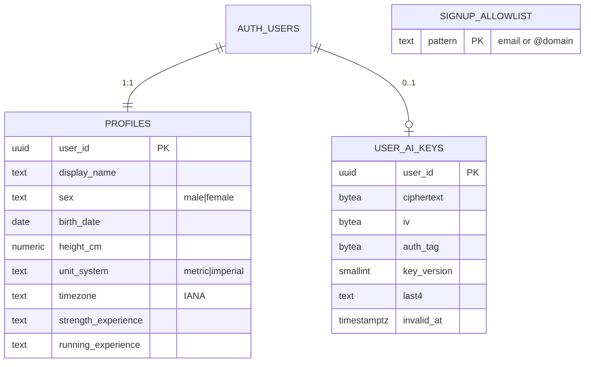
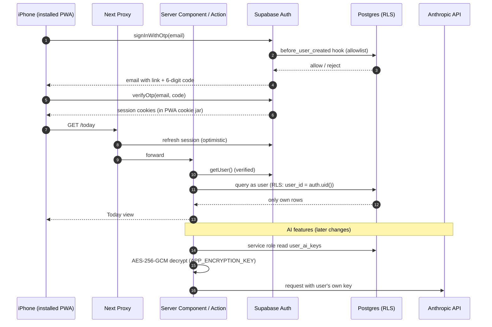
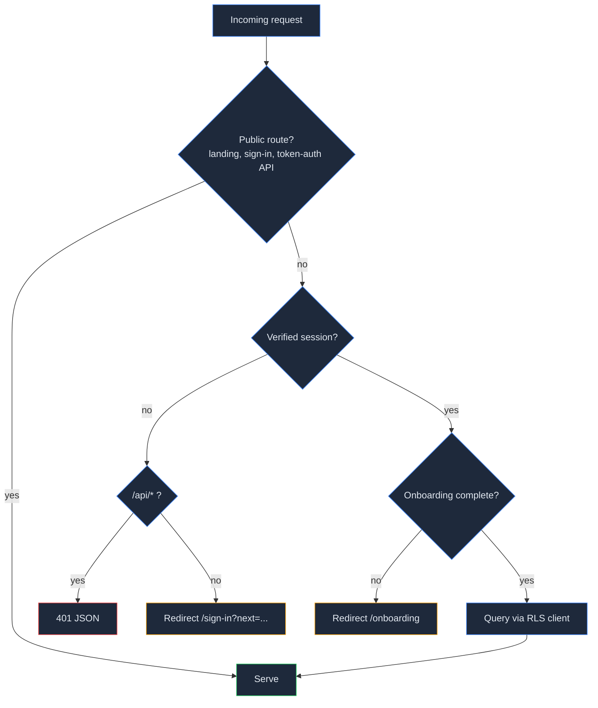

## Context

Greenfield repo: a `create-next-app` scaffold (Next.js 16.4, React 19.3, Tailwind 4, pnpm) plus OpenSpec. See proposal.md for motivation. Constraints that shape the design:

- **Next 16 renamed Middleware to Proxy** (`src/proxy.ts`, Node runtime only), and its docs say Proxy is for optimistic checks, not authorization. Real authorization lives in the data layer.
- **iOS home-screen web apps don't share cookies with Safari.** A magic link opened from Mail signs the user in to Safari, not to the installed app.
- Several friends will store **EU health data** (GDPR special category), and anyone can self-host from the public repo. Security can't depend on "only the maintainer runs it".
- Users pay for their own AI usage, so every AI call must be scoped to the caller's own key.

## Goals / Non-Goals

**Goals:**
- Conventions every later change copies without rethinking: table shape, RLS, storage paths, day boundaries, units, AI client access, test harness.
- Authorization enforced by Postgres RLS and Storage policies. Application code is a convenience layer, not the security boundary.
- Self-hosting = create Supabase project → run migrations → set 4 env vars → deploy to Vercel.

**Non-Goals:**
- Service worker / offline cache (manifest-only PWA is enough for iOS install).
- Rate limiting: AI costs fall on each user's own key; revisit if the ingest endpoint (`add-activity-sync`) needs it.

## Decisions

### D1. Supabase Auth email OTP (link + code in one email)
`signInWithOtp` with an email template that includes both `{{ .ConfirmationURL }}` and `{{ .Token }}`. The sign-in screen offers "enter code" right after sending. The code path solves the iOS PWA cookie-jar split.
*Alternatives:* magic link only (broken in the installed iOS app); passwords (more surface, more support); Apple/Google OAuth (has the same PWA redirect problem plus provider setup for every self-hoster).

### D2. Allowlist enforced by a Supabase "before user created" auth hook
A Postgres function `auth_hooks.before_user_created(event jsonb)` rejects the signup unless `public.signup_allowlist` is empty or one of its rows matches the email exactly or matches the domain (`@friends.dk`). Because it runs inside Supabase Auth, a client calling the Auth API directly with the anon key can't bypass it. Existing users are unaffected because the hook only fires on creation.
*Alternative:* checking an env var in a Next server action. It's trivially bypassed, since the anon key is public.

### D3. Session handling: `@supabase/ssr` cookies; Proxy refreshes the session only
- `src/proxy.ts`: refreshes the auth cookie and does an *optimistic* redirect of anonymous users to `/sign-in?next=…`, as the Next docs recommend.
- Server Components / Route Handlers / Server Actions call `supabase.auth.getUser()` (verified against Auth server) through a `requireUser()` helper. It returns 401 JSON for `/api/*` and redirects for pages.
- `requireUser()` also enforces "onboarding complete", redirecting to `/onboarding`.

### D4. Data-layer conventions (copied by every later change)

```sql
create table public.<thing> (
  id uuid primary key default gen_random_uuid(),
  user_id uuid not null default auth.uid() references auth.users(id) on delete cascade,
  occurred_at timestamptz not null default now(),   -- UTC instant
  local_date date not null,                          -- day in user's tz at write time
  ...,
  created_at timestamptz not null default now(),
  updated_at timestamptz not null default now()
);
alter table public.<thing> enable row level security;
create policy "<thing>_owner" on public.<thing>
  for all to authenticated
  using (user_id = (select auth.uid()))
  with check (user_id = (select auth.uid()));
create index on public.<thing> (user_id, local_date);
```

- `on delete cascade` from `auth.users` makes account deletion delete every row (D8).
- `local_date` is computed once at write time from the profile timezone. Records don't move days if the user later travels or changes timezone, which is the expected behaviour for a training log.
- `(select auth.uid())` wrapping keeps RLS per-statement rather than per-row (Supabase performance guidance).
- Storage: private buckets only; object paths are `<user_id>/<...>`; policies check `(storage.foldername(name))[1] = auth.uid()::text`. Files are served only via short-lived signed URLs.

### D5. Tables in this change



- `profiles` has CHECK constraints mirroring the spec ranges (height 100–250 cm). Age ≥ 13 is checked in Zod because it depends on today's date.
- `user_ai_keys` has RLS **enabled with no policies**, so `anon`/`authenticated` get nothing, including the owner (spec: "no ciphertext returned to any client"). Only the server-side service-role client in `src/server/ai/keys.ts` touches it.
- `signup_allowlist` has RLS enabled with no policies; only the auth hook (security definer) and the dashboard can read it.

### D6. BYO key: AES-256-GCM with an instance secret
- `APP_ENCRYPTION_KEY` = 32 random bytes, base64, set in Vercel env and never in the DB. Node `crypto` AES-256-GCM with a random 12-byte IV per encryption. `key_version` allows rotation (decrypt with old, re-encrypt with new).
- Validation: `GET https://api.anthropic.com/v1/models` with the candidate key. It authenticates without consuming tokens. 401/403 → rejected; network/5xx → "retry later" and nothing is stored.
- `getAnthropicClient(userId)` (server-only module, `import "server-only"`) decrypts and returns an SDK client, or throws `MissingAiKeyError`. An Anthropic 401 on any later call sets `invalid_at`, and the UI shows "key no longer valid". The key never appears in logs: the SDK client is constructed inside the module, and error objects are mapped to typed errors before being surfaced.
- Model IDs are constants in one module (`claude-opus-5-5` for vision/plans, `claude-haiku-4-5` for parsing), so later changes import them rather than repeating strings.

### D7. Time and units: pure, dependency-free modules
- `src/lib/time.ts`: `localDate(instant, tz)` via `Intl.DateTimeFormat('en-CA', { timeZone })`, plus `ageOn(birthDate, date)`. Fallback tz is `Europe/Copenhagen`.
- `src/lib/units.ts`: kg⇄lb, cm⇄ft/in, m⇄mi, with formatting per `unit_system`. Storage is always metric (project convention).
- Both are exhaustively unit-tested (DST transitions, 23:30 local, leap-day birthdays).

### D8. Export and deletion through a table registry
- `src/server/account/registry.ts` lists every user-owned table and storage bucket. Each later change appends its tables and buckets. A test asserts every `public` table with a `user_id` column is registered, so a forgotten table fails CI instead of silently leaking past export or deletion.
- Secret tables (`user_ai_keys`, later `ingest_tokens`) are registered with `export: false`. They're still covered by cascade delete and the completeness test, but skipped by export, so no hash or ciphertext can appear in an export even if RLS on them ever changes.
- **Export**: for each registered table, select the caller's rows with the *user's own* RLS client (so the export is RLS-scoped by construction). Files get signed URLs valid for 24 h. Output is `{ schema_version, exported_at, tables: {...}, files: [...] }`.
- **Delete**: (1) remove all objects under `<user_id>/` in every registered bucket via the Storage API (SQL deletes on `storage.objects` are blocked by Supabase); (2) `auth.admin.deleteUser(id)`, which cascades every row. Files are deleted first so a failure leaves a re-runnable state (idempotent: the second run finds no files and finishes).

### D9. PWA shell
- `src/app/manifest.ts` (name, `display: standalone`, theme colours, icons 192/512 + maskable), `apple-touch-icon`, `metadata.appleWebApp`, `viewport: { viewportFit: 'cover' }` and CSS `env(safe-area-inset-*)` padding for the notch and home indicator.
- Layout: route group `(app)` with a shell that renders a bottom tab bar under the `md` breakpoint and a sidebar from `md` up.
- UI kit: Tailwind 4 + shadcn/ui (Radix primitives, copied into `src/components/ui`) for accessible dialogs/forms; `lucide-react` icons. Theme follows `prefers-color-scheme`.

### D10. Testing strategy
| Layer | Tool | What |
|---|---|---|
| Pure logic | Vitest | units, time/day boundaries, crypto round-trip + tamper detection, allowlist matching, Zod schemas |
| Database | Vitest + local Supabase (`supabase start`, needs Docker) | RLS isolation with two real users, allowlist hook, cascade delete, registry completeness |
| E2E | Playwright against `next dev` + local Supabase (Mailpit catches emails) | sign-in via code, onboarding gate, settings key masking, export, delete |

### Request flow



### Route protection decision logic



## Risks / Trade-offs

- [Service-role key in the server bundle is a full bypass of RLS] → Used only in `src/server/**` modules marked `import "server-only"`. Only three call sites: AI key store, account deletion, export file signing. Grep-based test fails CI if it is imported anywhere else.
- [Losing `APP_ENCRYPTION_KEY` makes all stored AI keys unrecoverable] → Acceptable: users simply re-enter their key. README documents this, and `key_version` supports deliberate rotation.
- [Supabase free tier pauses inactive projects after a week] → README notes it. Daily Apple Health ingest (`add-activity-sync`) keeps an active instance warm.
- [iOS may evict an unused PWA's storage] → Session lives in cookies set by the server, and re-auth by code takes ~20 s. No local-only data exists to lose.
- [Health data under GDPR] → EU Supabase region and Vercel `fra1` documented as defaults; export + hard delete shipped from day one; Anthropic API inputs are not used for training by default (README states this, and AI features are opt-in by adding a key).
- [Allowlist mistakes lock out friends] → Hook only gates *creation*, and the maintainer edits a single table in the Supabase dashboard.

## Migration Plan

Greenfield. Deploy: create Supabase project (EU) → `supabase db push` → enable the `before_user_created` hook in Auth settings and set the email template (link + code) → set env vars in Vercel → deploy. Rollback = redeploy previous Vercel build; migrations are additive.
