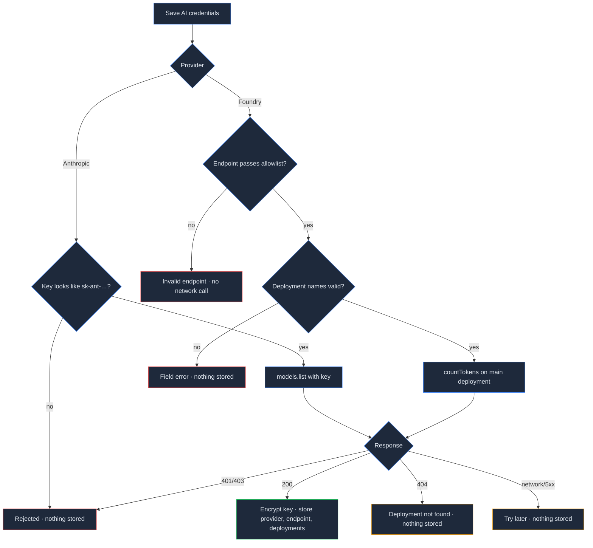

## Context

See proposal.md — Why. The BYO-key plumbing from `add-foundation` (D6) assumes Anthropic: `verify-key.ts` checks the `sk-ant-` shape and calls the Models API, `client.ts` builds `new Anthropic({ apiKey })`, and `structured.ts` always sends `betas: ["server-side-fallback-2026-07-01"], fallbacks: "default"` with the literal `AI_MODELS.main`. Call sites receive an SDK client through `withUserAnthropic(userId, call)`.

Facts relied on (installed `@anthropic-ai/foundry-sdk@0.6.0`, `client.d.ts`/`client.js`; claude-api skill `shared/platform-availability.md`):
- `AnthropicFoundry extends Anthropic`; options `resource` (→ `https://{resource}.services.ai.azure.com/anthropic/`) or `baseURL`, `apiKey`; auth header `x-api-key`; `messages` and `beta.messages` keep `parse`/`countTokens` (only `batches` removed); `models` is `undefined`.
- It depends on `@anthropic-ai/sdk >=0.115.1 <1` and dedupes to the app's 0.135, so `Anthropic.AuthenticationError` etc. are the same classes.
- Foundry supports structured outputs and token counting; it does not support the Models API or server-side `fallbacks`.

## Goals / Non-Goals

**Goals:** zero call-site churn for the seven AI features; strict SSRF guard; existing Anthropic rows untouched.

**Non-Goals:** see proposal; also no client-side refusal middleware.

## Decisions

### D1. One row per user, provider column
`user_ai_keys` gains `provider` (`anthropic` | `foundry`, default `anthropic`), `endpoint`, `main_deployment`, `fast_deployment`, with CHECKs: foundry ⇒ endpoint not null; anthropic ⇒ endpoint and deployments null. RLS stays enabled with no policies; the registry entry stays `export: false`. *Alternative:* a separate `user_ai_providers` table — rejected, one active credential set per user is the rule.

### D2. Endpoint parsing: build from the resource name
`parseFoundryEndpoint(input)` (pure, `src/lib/ai/foundry-endpoint.ts`) uses `URL`, then requires `protocol === "https:"`, empty `username`/`password`/`port`/`search`/`hash`, `pathname` ∈ {`/anthropic`, `/anthropic/`}, and hostname matching `^([a-z0-9-]+)\.services\.ai\.azure\.com$`. It returns the resource name; the client is constructed with `{ resource }`, so the SDK itself builds the URL from a validated label — no user string reaches `fetch`. *Alternative:* passing the user's URL as `baseURL` — rejected, it widens the trust boundary.

### D3. Verification by provider
- Anthropic: unchanged (key shape + `models.list`).
- Foundry: `client.messages.countTokens({ model: mainDeployment, messages: [{ role: "user", content: "ping" }] })` with `maxRetries: 0`, 10 s timeout. `AuthenticationError`/`PermissionDeniedError` → `rejected`; `NotFoundError` → `deployment_not_found`; anything else → `unavailable`. Key: non-empty, ≤ 200 chars, no whitespace.

### D4. Client metadata without call-site churn
`getAnthropicClient(userId)` returns an `Anthropic` (or `AnthropicFoundry`, a subclass). Provider and resolved models are recorded in a module-level `WeakMap<object, AiMeta>`; `aiMetaOf(client)` returns it, defaulting to `{ provider: "anthropic", models: AI_MODELS }` for unregistered clients (test doubles). Call sites that named `AI_MODELS.main/fast` switch to `aiMetaOf(client).models.*`; literal model IDs stay only in `client.ts`. *Alternative:* changing every callback to receive `{ client, models, provider }` — rejected, touches ~15 call sites and their tests for no behavioural gain.

### D5. Structured helper and refusals
`parseStructured` sends `betas`/`fallbacks` only when `aiMetaOf(client).provider === "anthropic"`, uses the resolved main model, and throws `AiRefusalError` on `stop_reason === "refusal"` (null is still returned for unparsable output). Feature error mappers (nutrition, body, coach) translate `AiRefusalError` to an `ai_declined` code (HTTP 422) with "Claude declined this request…"; the two retry loops that swallow non-API errors (meal recognition, meal suggestions) re-throw it. Voice parsing keeps returning null on refusal (falls back to the confirmation card).

### Key save / validation flow

## Risks / Trade-offs

- [No refusal fallback on Foundry → more declined requests there] → clear `ai_declined` message; users can retry with different input.
- [Users deploy Claude under custom names] → optional deployment-name fields, and a "deployment not found: <name>" message at save time.
- [Employer Azure subscriptions] → explicit notice in Settings; nothing technical can detect ownership.
- [WeakMap metadata is implicit] → single accessor `aiMetaOf` with a safe Anthropic default; covered by unit tests.

## Migration Plan

Additive migration with defaults; existing rows become `provider = 'anthropic'`. Deploy = `supabase db push` then Vercel deploy. Rollback = redeploy previous build (extra columns are ignored by old code).
