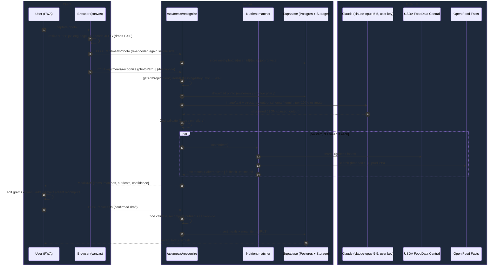
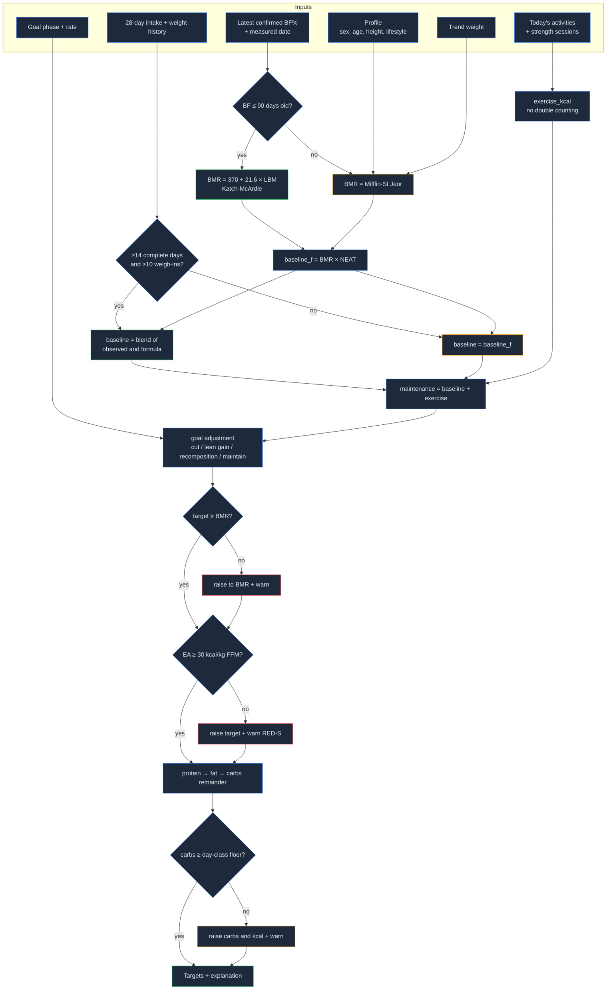

## Context

See proposal.md (Why). This change consumes data owned by earlier changes and owns none of it:

- `add-foundation`: profile (sex, birth date, height, timezone), encrypted BYO Claude key via `getAnthropicClient(userId)` + model constants, data-layer conventions (foundation design D4), export/delete table registry (foundation design D8).
- `add-workout-logging`: strength sessions with start/end timestamps.
- `add-activity-sync`: `activities` (sport, start/end, moving duration, active kcal) and `daily_metrics`.
- `add-body-tracking`: daily trend weight, latest confirmed body fat % / lean mass with measurement date, goal (goal weight, goal body fat %, phase ∈ cut / lean gain / recomposition / maintain, optional weekly rate).

The constraints that shape the design: targets are deterministic and never LLM-derived; AI output is Zod-validated and confirmed before saving; storage is canonical metric; day boundaries use the user's timezone; GDPR-grade privacy for photos.

## Goals / Non-Goals

**Goals:**
- One pure, fully unit-tested target engine (`computeDailyTargets`) with no I/O, so every formula in the specs is a table-driven test.
- A single "meal draft" pipeline shared by photo, text description, planned-meal and re-log entry points, so confirmation and saving are written once.
- Nutrient lookups that never block the confirmation screen.

**Non-Goals:**
- Caching or mirroring the USDA / Open Food Facts databases locally (live lookups only, small per-user cache).
- Server-side image processing (resize and EXIF strip happen in the browser).
- Streaming AI responses into the UI.

## Decisions

### D1. Target engine is a pure function plus a thin loader
`src/lib/nutrition/targets.ts` exports `computeDailyTargets(inputs): TargetsResult` where `inputs` is a plain object (profile, trend weight, latest body fat, goal, activities for the day, strength sessions, adaptive window stats, lifestyle level). It returns targets plus an ordered `components[]` explanation list. A server loader assembles the inputs from Supabase.
*Alternative:* SQL view/function computing targets in Postgres. Rejected: harder to unit test, and the explanation output is awkward in SQL.

### D2. Exact formulas

```
age            = full years from birth_date to the local date
LBM            = trend_weight × (1 − bf% / 100)               # only if confirmed bf ≤ 90 days old
BMR            = 370 + 21.6 × LBM                              # Katch-McArdle
               | 10 × W + 6.25 × H − 5 × age + (male ? 5 : −161)  # Mifflin-St Jeor fallback
NEAT_factor    = {sedentary: 1.2, lightly_active: 1.35, active: 1.5}
baseline_f     = BMR × NEAT_factor                             # non-exercise expenditure, formula

exercise_kcal  = Σ activity.active_kcal (local day)
               + Σ strength_session not overlapping any activity with active_kcal:
                   5 × W × duration_h                          # MET 5 estimate

# Adaptive (window = trailing 28 local days ending yesterday)
eligible       = complete_days ≥ 14 AND weigh_ins ≥ 10
TDEE_obs       = mean(intake_kcal over complete days) − (trend_W[end] − trend_W[start]) × 7700 / window_days
baseline_obs   = TDEE_obs − mean(exercise_kcal over window days)
w              = eligible ? min(1, complete_days / 28) : 0
baseline       = w × baseline_obs + (1 − w) × baseline_f

maintenance    = baseline + exercise_kcal
goal_adj       = cut:            −min(rate_kg_wk × 7700 / 7, 0.25 × maintenance), rate default 0.005 × W
               | lean_gain:      +250
               | recomposition:  −0.05 × maintenance
               | maintain:       0
target         = maintenance + goal_adj
target         = max(target, BMR)                              # floor 1 (warn if applied)
if FFM known:  target = max(target, exercise_kcal + 30 × FFM)  # floor 2, RED-S (warn)

ref_W          = (bf% > 25 male | > 32 female) AND goal_weight ? goal_weight : W
protein_g      = (phase ∈ {cut, recomposition} ? 2.0 : 1.8) × ref_W
fat_g          = max(0.25 × target / 9, 0.6 × W)
carb_g         = (target − 4 × protein_g − 9 × fat_g) / 4
day_class      = longest run ≥ 90 min → long (6 g/kg) | ≥ 60 min → run (5 g/kg) | else easy/rest (3 g/kg)
if carb_g < floor × W:  target += 4 × (floor × W − carb_g); carb_g = floor × W   # floor 3 (warn)
fiber_g        = 14 × target / 1000
```

All outputs are rounded only at the end (kcal to 10, grams to 1) so explanation components sum exactly to the displayed values (rounding residue is assigned to the baseline component). "Run" means activities whose sport is running/trail running. Planned-but-not-done runs are ignored here; `add-coach` adds planned sessions later.

### D3. Target persistence: live today, frozen history
`daily_nutrition_targets(user_id, local_date, targets jsonb, components jsonb, computed_at)`. Today is always computed on read (cheap) and upserted. Days before today are never recomputed once a row exists. The first read after midnight freezes yesterday's last computation, and a missing past row is computed once from the data as it stands. Activity sync needs no hook: the next read recomputes.
*Alternative:* trigger-based recomputation on every activity/meal insert. Rejected: couples three changes' tables and adds write amplification for no user-visible gain.

### D4. Meal draft pipeline



- **AI client:** every call goes through foundation's `getAnthropicClient(userId)` and its model constants (vision → `AI_MODELS.main`). `MissingAiKeyError` is mapped to HTTP 409 `{ code: "missing_ai_key" }`; the UI then hides photo/description/recommendation entry points and keeps manual food search and re-log available. Anthropic 401s surface as foundation's typed invalid-key error.
- **Photo access:** the stored photo is read by the server through a short-lived signed URL (foundation D4) and sent to Claude as base64; photos are never public.
- **Structured output:** Claude is called via `messages.parse` with `output_config.format = zodOutputFormat(MealItems)` (forced `tool_choice` is rejected by Opus 5.5); `parsed_output` is the Zod-validated result. Each item also carries the model's per-100 g nutrient estimate, so the "estimated" fallback needs no second AI call.
- **Text descriptions** call the same endpoint without an image. The schema has `quantity_source: "user" | "estimated"`.
- **Re-log, favourites and planned meals** build a `MealDraft` directly from stored items (no AI, no lookup), then go to the same confirm/save path.
- **Server recomputes nutrients on save** from per-100 g data × grams. Client-sent totals are never trusted.

### D5. Nutrient matching strategy
The matcher queries USDA FDC `/foods/search` (dataTypes `Foundation`, `SR Legacy`, `Survey (FNDDS)`) and Open Food Facts search in parallel with a 3 s timeout each. It picks OFF when the item name includes a brand or the model flagged it `packaged: true`, USDA otherwise. The top 5 candidates are returned as swap alternatives. Results are cached in `food_lookup_cache(query_normalized, source, payload, fetched_at)` for 30 days to protect the instance's USDA quota (1000 req/h per key). Nutrient IDs are mapped once in `src/lib/nutrition/nutrients.ts` (e.g. USDA 1008 kcal, 1003 protein, 1005 carbs, 1004 fat, 1079 fiber, 2000 sugar, 1258 sat fat, 1093 sodium, 1092 K, 1087 Ca, 1089 Fe, 1090 Mg, 1114 vit D µg, 1178 B12). Values missing from the source are stored as `null`.
*Alternative:* ask Claude for all nutrients. Rejected as the primary path: databases are more accurate and give real micronutrients; the model is only the fallback.

### D6. Data model
Every user-owned table follows foundation design D4: `user_id uuid not null default auth.uid() references auth.users(id) on delete cascade`, owner policy `for all to authenticated using/with check (user_id = (select auth.uid()))`, `created_at`/`updated_at`, and an index on `(user_id, local_date)` where `local_date` exists. Event tables carry `occurred_at timestamptz` and a `local_date` computed **once at write time** from the profile timezone using foundation's time module. Child rows follow the same ownership and policy pattern even though ownership is implied by the parent, so RLS never depends on a join.

| Table | Key columns (beyond the D4 base columns) |
|---|---|
| `meals` | occurred_at (when eaten), local_date, meal_type enum, source enum(photo,text,search,relog,planned), photo_path, is_favorite, name |
| `meal_items` | meal_id → meals on delete cascade, name, grams, quantity_source, confidence, nutrient_source enum(usda,off,estimated), source_ref, per100g jsonb, kcal, protein_g, carb_g, fat_g, fiber_g, sugar_g, satfat_g, sodium_mg, potassium_mg, calcium_mg, iron_mg, magnesium_mg, vitamin_d_ug, b12_ug (nullable micros) |
| `food_log_days` | local_date, is_complete; unique (user_id, local_date) |
| `daily_nutrition_targets` | local_date, targets jsonb, components jsonb, method, computed_at; unique (user_id, local_date) |
| `planned_meals` | local_date, slot, items jsonb, logged_meal_id → meals null |
| `food_lookup_cache` | instance-wide, **no user data and no `user_id`**; RLS enabled with no policies (service role only) |
| `profiles` (+cols) | lifestyle_level, diet_type, allergies text[], dislikes text[], cuisines text[] |

Storage: private bucket `meal-photos`, object path `<user_id>/<meal_uuid>.jpg`, foundation's folder-owner policy, served only via short-lived signed URLs.

**Export/delete registry (foundation D8):** `meals`, `meal_items`, `food_log_days`, `daily_nutrition_targets`, `planned_meals` and the `meal-photos` bucket are appended to `src/server/account/registry.ts`. The new profile columns are covered by the existing `profiles` entry. The registry test fails CI if any of these is forgotten.

Explicit nutrient columns (not JSONB) on `meal_items` let day totals be a simple `SUM … GROUP BY local_date`. `SUM` ignores nulls, so the UI flags micros as incomplete when any item's value is null.

### D7. Recommendations
`POST /api/nutrition/recommendations` (via `getAnthropicClient(userId)`, `AI_MODELS.main`; `MissingAiKeyError` → 409) builds a prompt from: remaining targets (from D1), remaining slots (by local time: before 10:30 → breakfast, lunch, snack, dinner; ... after 21:30 → snack only), diet type, allergies, dislikes, cuisines, today's runs (done + time) and body weight for per-meal protein. Claude returns via structured output (`messages.parse` + `zodOutputFormat`, schema `MealOptions`) → Zod → server post-processing:
1. Recompute each option's macros through the D5 matcher (falls back to model numbers, labelled estimate).
2. Drop options with |kcal − remaining| > 15%.
3. **Allergen filter**: normalise food names and check against an allergen synonym map (`src/lib/nutrition/allergens.ts`: e.g. peanut → peanut, satay, groundnut; milk → whey, casein, skyr, cheese, butter, yogurt; gluten → wheat, barley, rye, couscous, seitan; plus the 14 EU allergen groups). Any hit drops the option. Free-text allergies not in the map are matched literally as substrings.
4. If < 1 option survives, regenerate once with the rejection reasons, then give up gracefully.

Recommendations are not persisted unless the user saves one as `planned_meals`.

### D8. Daily target graph



### D9. Client-side image processing
`createImageBitmap(file, { imageOrientation: "from-image" })` → canvas at ≤1568 px → `canvas.toBlob("image/jpeg", 0.85)`. Re-encoding from canvas drops all EXIF, including GPS, and bakes in orientation. HEIC from iPhone is decoded natively by Safari. A unit test asserts that the output blob has no APP1/Exif marker.

## Risks / Trade-offs

- [Photo portion estimates are inaccurate (±20–30%)] → Show confidence and the accuracy notice, make gram editing the primary interaction, keep the adaptive expenditure model that self-corrects systematic logging bias over weeks.
- [USDA quota is per instance (1000 req/h) and shared by all friends] → 30-day lookup cache, parallel calls only for unmatched items, and a graceful "estimated" fallback when throttled.
- [Open Food Facts data quality varies] → Prefer USDA for generic foods; show source; allow swap.
- [Watch active kcal is often overestimated] → Accepted for v1. The adaptive baseline absorbs consistent bias because it subtracts the same exercise_kcal series it later adds back, and the explanation makes the activity contribution visible.
- [Allergen filtering via a synonym map can miss obscure ingredients] → The UI states that suggestions are not a substitute for checking ingredients, and the server filter is strict (substring match, drop on any hit).
- [Long-run carb floor can raise kcal well above the cut target] → Intentional (performance and RED-S safety over the deficit on that day). The warning explains it, and the weekly average remains in deficit.
- [LLM latency for vision (several seconds)] → Optimistic UI with a progress state. Upload happens in parallel with recognition start.

## Migration Plan

Additive only: new tables (D4 shape), new profile columns with defaults (`lifestyle_level = 'sedentary'`, `diet_type = 'omnivore'`, empty arrays), new private bucket with owner-only policies. New **instance-level** env var `USDA_FDC_API_KEY` (free data.gov key, one per deployment; never per user), added to the env Zod schema as optional and documented in `.env.example` and the README self-hosting guide. When it is absent, USDA matching is skipped and OFF/estimated are used. Rollback: drop the new tables and columns. No existing data is modified.

## Open Questions

- Exact allergen synonym list content beyond the EU 14 groups can grow with usage without changing specs.
- Whether to show weekly average intake vs. weekly average target on the Eat tab (UI polish, decide during implementation).

### Implementation notes (decided while building)

- **Shared AI helper.** `src/server/ai/structured.ts` (`parseStructured`) is the one place that calls `beta.messages.parse` with `AI_MODELS.main`, `effort: "medium"`, `fallbacks: "default"` and a Zod output format. It was extracted here (third and fourth use) and body-tracking's report extraction and photo analysis now use it too.
- **Photo path.** The browser re-encodes to ≤ 1568 px JPEG (`reencodeForUpload(file, max, 1568)`) and posts to `POST /api/meals/photo`; the server re-encodes again with sharp (same normaliser as body-tracking, now with a `maxLongEdge` option) and stores `meal-photos/<user_id>/<uuid>.jpg`. Recognition downloads the photo with the user's own storage client (owner-only policy) instead of minting a signed URL, then sends base64 to Claude. Unreferenced photos older than 24 h are removed lazily on the user's next upload.
- **Recognition validation.** Besides Zod, items must be plausible (0 < grams ≤ 5000, ≤ 900 kcal and ≤ 100 g of each macro per 100 g); an SDK output-parsing error counts as invalid output. Either triggers the single retry. A `"user"` quantity is kept only when that gram amount literally appears in the description; photo-only items are always `"estimated"`.
- **Diet type is also enforced server-side** (keyword filter in `src/lib/nutrition/allergens.ts`) alongside the allergen filter, so a vegetarian never sees a chicken option even if the model ignores the prompt.
- **"Target met" snack.** When remaining kcal ≤ 0 no AI call is made; the user can explicitly ask for light high-protein snack ideas (`mode: "light_snack"`, ≤ 250 kcal each).
- **Runs for recommendations.** Only runs already recorded today are passed; planned runs arrive with `add-coach`. The slot guidance logic (pre-long-run / post-run) is already in place and tested with planned runs.
- **Lookup cache** is read and written only through the service-role client in `src/server/nutrition/lookup-cache.ts` (added to the admin-import allowlist); failures and timeouts are never cached.
- **No env schema module exists** in the project, so `USDA_FDC_API_KEY` is read directly where the matcher dependencies are built; absent → USDA is skipped.
- **meal_items ownership.** RLS checks `user_id`; a trigger additionally requires the parent meal to belong to the same user, so an item can't be attached to someone else's meal.
- **Exercise energy inputs.** Activity duration is `moving_s ?? elapsed_s`, active kcal is `activities.calories_kcal`; an open (unfinished) strength session counts until now, capped at 3 h.
- **Adaptive window trend** is measured per day from the trend point the day before the window (or the first available point) to yesterday.
- **Tests.** Component tests render static markup (no DOM), so "changing grams updates totals" is verified via the pure `draftEditor` reducer plus rendering the result. The E2E stubs only the two AI endpoints in the browser (server-side calls can't be intercepted); it runs in the Chromium iPhone project and was verified on WebKit iPhone with a one-off config. Shared E2E helpers now wait for hydration (WebKit hydrates later).
- **Mermaid:** the Open Food Facts participant is `OFFDB` because `OFF` is a reserved word in sequence diagrams.
