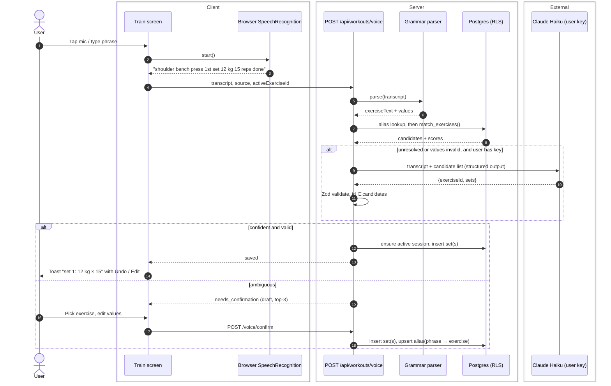
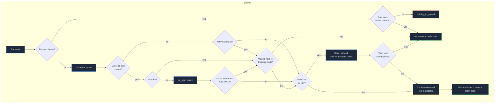
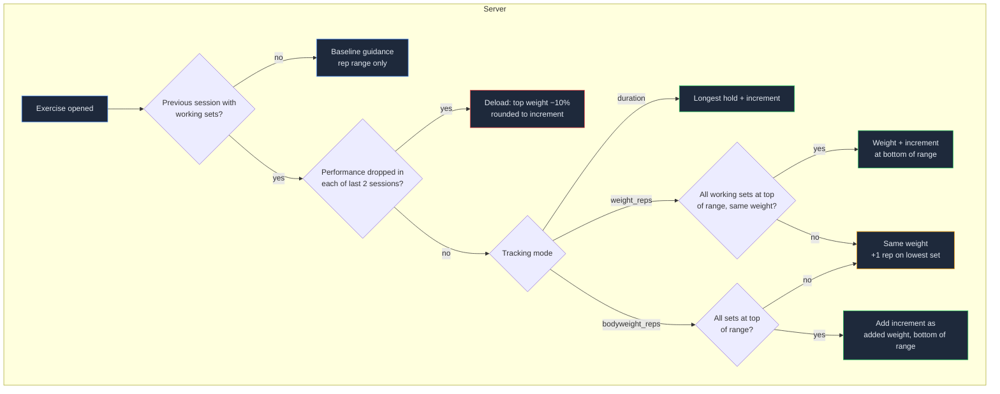

## Context

Builds on `add-foundation`: Supabase auth + RLS, profile `unit_system` and `timezone`, the `ai-key` server helper that returns an Anthropic client for the signed-in user (or "no key"), and the app shell's Train tab. See proposal.md for motivation and the four specs for required behaviour.

Constraints that shape this design:
- Logging happens mid-set on an iPhone, often with poor signal. Every round trip matters, and the common path must not depend on an LLM.
- Speech recognition quality on iOS varies, and home-screen (standalone) PWAs have historically had flaky `SpeechRecognition` support, so the text field + keyboard dictation path is a first-class input rather than a degraded one.
- Users bring their own AI key, so AI use must be the exception, and the feature must fully work without a key.

## Goals / Non-Goals

**Goals:**
- One server-authoritative pipeline turns a transcript into saved sets or a confirmation draft. Voice, typed text and "same again" all use it.
- Deterministic parsing and resolution handle the large majority of real utterances, measured against a fixture corpus.
- Progression logic and the parser are pure functions, fully unit-testable without a database.

**Non-Goals:**
- Streaming / partial-transcript parsing while the user is still speaking.
- Multi-language utterances (English only for v1. The grammar is table-driven so other languages can be added later).
- Re-hosting exercise images.

## Decisions

### D1. Data model

User-owned tables follow foundation design D4 exactly:
- `user_id uuid not null default auth.uid() references auth.users(id) on delete cascade`
- `created_at` / `updated_at`
- `occurred_at` + `local_date` where the row is a dated event, with `local_date` computed once at write time from the profile timezone via `src/lib/time.ts`
- RLS owner policy `using/with check (user_id = (select auth.uid()))`
- index on `(user_id, local_date)` for dated tables

| Table | Key columns | Notes |
|---|---|---|
| `exercises` | `id uuid`, `source_id text unique null`, `user_id uuid null references auth.users on delete cascade`, `name`, `category`, `equipment`, `level`, `mechanic`, `force`, `tracking_mode`, `instructions text[]`, `image_paths text[]`, `archived_at` | **Deliberate deviation from D4**: `user_id` is nullable. `null` = seeded/shared; set = private custom. CHECK `(source_id is null) <> (user_id is null)`. GIN `pg_trgm` index on normalised name. |
| `exercise_muscles` | `exercise_id references exercises on delete cascade`, `muscle_group` enum, `role` (`primary`/`secondary`) | PK on all three columns. No `user_id`: ownership is inherited from the parent exercise. |
| `exercise_aliases` | D4 shape (undated) + `phrase_normalised`, `exercise_id` | Unique `(user_id, phrase_normalised)`. |
| `exercise_settings` | D4 shape (undated) + `exercise_id`, `rep_min`, `rep_max`, `increment_kg`, `duration_increment_s` | Unique `(user_id, exercise_id)`. Overrides only. Defaults are computed in code. |
| `workout_sessions` | D4 shape: `occurred_at` (= start), `local_date`, plus `finished_at` | Partial unique index on `(user_id) where finished_at is null` enforces one active session. |
| `workout_sets` | D4 shape: `occurred_at` (= logged at), `local_date` (copied from session), plus `session_id references workout_sessions on delete cascade`, `exercise_id`, `set_number`, `set_type`, `weight_kg numeric(6,2)`, `reps`, `duration_s`, `distance_m`, `rpe numeric(3,1)`, `source` (`manual`/`voice`/`text`), `transcript text` | Unique `(session_id, exercise_id, set_number)` `deferrable initially deferred` so renumbering inside one transaction is legal. CHECK constraints mirror the spec's validation ranges. |

Foreign keys from `workout_sets`, `exercise_aliases` and `exercise_settings` to `exercises` use the default `no action`, not `restrict`. This lets the single cascading delete from `auth.users` remove a user's custom exercises and their sets in one statement (account deletion, foundation D8).

RLS:
- `exercises` select: `user_id is null or user_id = (select auth.uid())`. Insert, update and delete only where `user_id = (select auth.uid())`, so seeded rows are immutable to users.
- `exercise_muscles` select follows the parent exercise's visibility, and writes require the parent to be owned (an `exists` subquery on `exercises`).
- All other tables use the standard D4 owner policy. `workout_sets.user_id` is denormalised so RLS doesn't need a join.

Account registry (foundation D8): this change appends `exercises` (export filtered to `user_id = (select auth.uid())`, with nested `exercise_muscles`), `exercise_aliases`, `exercise_settings`, `workout_sessions` and `workout_sets` to `src/server/account/registry.ts`. The registry completeness test then covers them. This change adds no storage buckets: exercise images stay remote (D2).

Alternative considered: a JSON `sets` column on the session. Rejected because per-exercise history, volume aggregation and CHECK constraints all want relational rows.

### D2. Seeding from free-exercise-db
`pnpm seed:exercises` fetches `dist/exercises.json` from `yuhonas/free-exercise-db` at a **pinned commit SHA** (recorded in the script), transforms each record, and upserts it on `source_id` using the service-role client. `exercise_muscles` rows for seeded exercises are replaced inside the same transaction. User tables are never touched, which keeps the seed idempotent (spec: Idempotent seeding).

Muscle mapping, as a static table in code:

| Source | App group |
|---|---|
| abdominals | core |
| lower back, middle back, lats, traps | back |
| chest | chest |
| shoulders, neck | shoulders |
| biceps / triceps / forearms / calves / hamstrings / glutes | same name |
| quadriceps, adductors | quads |
| abductors | glutes |

- Category `cardio` adds `cardio`.
- Category `olympic weightlifting`, or exercises with primaries in 3+ distinct regions, add `full body`.

Tracking mode is derived in this order:
1. An explicit override map for known exceptions (e.g. Farmer's Walk → `distance_duration`).
2. Name matches the hold regex (`plank|hold|wall sit|hang|l-sit|hollow|bridge hold`) → `duration`.
3. Category `cardio` → `distance_duration`.
4. Equipment `body only` → `bodyweight_reps`.
5. Otherwise `weight_reps`.

Images are referenced at `https://raw.githubusercontent.com/yuhonas/free-exercise-db/<sha>/exercises/<path>` and allowed via `next.config` `images.remotePatterns`.

### D3. Fuzzy matching in Postgres (`pg_trgm`), not client-side
Search and voice resolution share one SQL function, `match_exercises(query text, limit int)`. It runs with security invoker, so RLS filters custom exercises automatically, and returns `(exercise_id, name, score)` using `similarity()` over a normalised name.

Normalisation is done in TypeScript before the call:
- lowercase and strip punctuation
- trivial singularisation
- synonym expansion: `db→dumbbell`, `bb→barbell`, `kb→kettlebell`, `ohp→overhead press`, `pull ups→pull-up`, `press ups→push-up`

Alternative: Fuse.js over a client-cached list. Rejected because the server needs the same matcher for voice auto-save decisions, and keeping two matchers in sync invites drift.

Confidence rule (constants in one module, tuned against the fixture corpus):
- **confident** = alias hit, OR (`top.score ≥ 0.55` AND `top.score − second.score ≥ 0.10`)

### D4. Deterministic grammar first, LLM only as fallback
The parser in `src/lib/voice/parse.ts` is a pure, table-driven tokenizer and grammar. It:
- normalises number words ("twelve" → 12)
- handles homophones in numeric slots ("for" → 4, "to"/"too" → 2, but only next to a unit or "reps")
- extracts `{exerciseText, sets[]: {weightKg, reps, durationS, distanceM}, repeat: boolean}`

It is driven by a fixture corpus (`parse.fixtures.ts`, ≥ 50 utterances, including every spec scenario). The fixture test fails if the deterministic coverage rate drops below the recorded baseline.

The LLM fallback runs in the server route only. The client comes from foundation `getAnthropicClient(userId)` and the model id from the shared model-constants module (the parsing model, `claude-haiku-4-5`), using a tool/JSON-schema output. `MissingAiKeyError` is caught and treated as "no key": the deterministic draft goes straight to the confirmation card. The prompt includes:
- the transcript
- the active exercise
- the top-10 trigram candidates plus the user's 10 most recent exercises, as `{id, name}`

Output is Zod-validated and the exercise id must be in the supplied list (spec: AI fallback). Timeout is 8 s. On error or invalid output, the deterministic draft is returned.

Alternative: LLM for every utterance. Rejected on latency (an extra network round trip mid-set), cost to the user's key, and failure without a key or signal.

### D5. Server-authoritative voice endpoint
All workout routes authenticate with foundation `requireUser()` (401 JSON when there is no session) and query through the user's RLS client. None are token-auth endpoints, so they stay behind the Proxy matcher.

`POST /api/workouts/voice` takes `{ transcript, source, activeExerciseId? }` and returns one of:
- `{ status: "saved", sets: [...] }`, with undo done by `DELETE /api/workouts/sets/:id`
- `{ status: "needs_confirmation", draft: { sets, candidates[≤3], parsedBy: "grammar" | "ai" } }`
- `{ status: "nothing_to_repeat" }`

The server decides auto-save, so the rule lives in exactly one place. It starts a session when none is active, and it writes the alias when the client confirms a draft via `POST /api/workouts/voice/confirm` with `{ draft, chosenExerciseId, phrase }`.

### D6. Set renumbering
A `delete_set(set_id)` SQL function (security invoker) runs in one transaction:
1. deletes the set
2. renumbers remaining sets for that `(session, exercise)` by `row_number() over (order by created_at)`

The deferred unique constraint makes this safe. Undo uses the same function.

### D7. Weekly muscle volume as a SQL function
`weekly_muscle_volume(p_week_start date)` returns `(muscle_group, sets numeric)`. It computes ISO weeks from `workout_sets.local_date`, joins `exercise_muscles`, weights primary 1.0 and secondary 0.5, and excludes `set_type = 'warmup'`. It is used by Train now and by `add-coach` later.

### D8. Progressive overload as a pure function
`suggestNext(exercise, settings | null, recentSessions: SetSummary[][])` returns `Baseline | Progress | Deload`.

- Compound vs isolation comes from source `mechanic` (`compound` / `isolation`). Unknown values default to compound.
- The default increment is chosen by equipment. Results are rounded to the increment.
- Estimated 1RM uses Epley: `w × (1 + reps/30)`.
- The function is computed on read when an exercise is opened. Nothing is persisted.

### Flow: voice log

### Decision logic: parse, resolve, save

### Decision logic: progressive overload

### Implementation notes (decided while building)
- **Aliases and progression overrides cascade** with their exercise (`on delete cascade`); `workout_sets → exercises` stays `no action` so history blocks hard-deleting a used exercise (it is archived instead).
- **Seeding is one SQL function**, `seed_exercises(jsonb)` (security definer, service role only), so each batch upserts exercises and replaces their muscles in a single transaction.
- **Tracking-mode rules** gained two cases found in the data: category `stretching` → `duration`, and the hold regex no longer matches `hang` (it caught "Hang Clean" and "Hanging Leg Raise"). The override map also covers Sled Push, Weighted Pull Ups and Push Up to Side Plank. Exercises with no source primary muscle get `full_body`.
- **Match score** is the mean of `similarity()` and `word_similarity()`, so "barbell squat" beats every name that merely contains "squat". `match_exercises()` also takes optional muscle/equipment filters and returns the primary groups, so the library UI uses the same function.
- **Session times use the database clock.** `occurred_at` defaults to `now()`, and `finish_session()` sets `finished_at = greatest(now(), occurred_at)`; app-server clock skew could otherwise violate `finished_at ≥ occurred_at`.
- **AI fallback output always goes to the confirmation card** (spec: "Messy phrase recovered by AI"), never straight to auto-save. It runs only when the grammar/fuzzy path can't auto-save, and only for users with a key.
- **Confidence thresholds** 0.55 / 0.10 held up against the seeded library: specific names ("dumbbell shoulder pres", "barbell squat", "plank") resolve, generic ones ("shoulder press", "squat", "curl") go to the card. Grammar coverage baseline: 63/64 fixtures.

## Risks / Trade-offs

- [iOS standalone PWA `SpeechRecognition` unreliable] → Feature-detect at runtime. The text field with keyboard dictation is always visible, and the same endpoint serves both paths.
- [Speech homophones ("for reps" → 4 reps?)] → Homophone mapping applies only in numeric slots next to units/"reps". Fixture tests cover known confusions. Auto-save always shows undo.
- [Fuzzy thresholds auto-save the wrong exercise] → Thresholds are conservative. Aliases are learned from confirmations, and each saved toast names the exercise explicitly with an Edit action. Thresholds are tuned by the fixture corpus, not guessed.
- [free-exercise-db naming is inconsistent (e.g. several "Shoulder Press" variants)] → Ambiguity routes to the confirmation card, and aliases remove the friction after the first time.
- [GitHub raw hotlinking rate limits or the repo disappears] → The commit SHA is pinned. If images break, they can be mirrored to Supabase Storage without schema changes (`image_paths` are relative).
- [Server-side parsing adds a network hop even for deterministic cases] → Accepted: one source of truth for the save decision outweighs ~100 ms. The parser is isomorphic, so a client pre-parse can be added later if needed.
- [Deferred unique constraint complexity] → Isolated to `delete_set()` and covered by an integration test.

## Migration Plan

Additive only: new migrations plus a seed command. Deploy order:
1. migrations
2. `pnpm seed:exercises` against the target project
3. app deploy

Rollback means reverting the app deploy. The tables can remain, since nothing else depends on them yet.

## Open Questions

- Exact fuzzy confidence constants (0.55 / 0.10) are starting points, finalised by the fixture corpus during implementation without changing behaviour contracts.
